# Scenarios

## Overview

*Source: BFG:XR Rulebook, printed p.77.*

Although some space battles are straightforward affairs, with two fleets engaging each other simply to destroy the enemy, it is just as likely that the fleets will have a more specific objective to achieve, such as escorting a convoy or supporting a planetary assault. This section of Battlefleet Gothic provides the rules for fighting these different types of battle. There are a number of scenarios in this book, divided between simple training missions for beginners, small scale raids, larger, full-scale battles, and a selection of unique, climactic showdowns for the especially adventurous commander.

*Flavour text (Port Maw):* Port Maw is the capital system of the Gothic Sector. The planet itself is the most productive hive world in the region, with a population of over 200 billion people. Orbiting above the world are three Naval stations, including Fleet Command for the whole of Battlefleet Gothic, and Nexus Station, the Gothic Sector's largest shipbuilding and repair station. Port Maw's orbital defenses outmatch even those of the Blackstone Fortresses, and the Chaos fleet wisely decided not to launch an all-out attack against this base. Instead, the naval base was blockaded continuously for seven years by Chaos ships. During this time, only a handful of vessels managed to slip into or out of the system and the need for food and supplies became great. After seven years, a brief break in the warpstorms around the sub-sector gave the battlecruiser Sword of Redemption and several other capital ships the opportunity to launch an effective attack, driving the Chaos blockade from the system and allowing the navy to make much-needed use of Port Maw's considerable shipyard facilities.

## Choosing a Scenario

*Source: BFG:XR Rulebook, printed p.78.*

For your first couple of games we recommend you play the Cruiser Clash introductory scenario a few times, to get used to the rules and start building up your fleet. Once you have an idea of how everything works you can try out some of the different scenarios that follow. When you feel comfortable with the rules, you may use any of the methods below to pick out scenarios for your regular play-group or tournament:

**Arbitrary Selection:** This is by far the quickest and easiest method of choosing a scenario. Both players simply pick out the scenario they want to play (or even make one up!).

**Random Selection:** If you wish to pick a scenario randomly, roll a D6. On a roll of a 1, 2 or 3, roll again on the Raids table. On a roll of a 4 or more, roll on the Battles table. Alternatively you can just decide whether you want to fight a raid or a battle and then roll on the appropriate table.

**Use Attack Ratings:** For more narrative games, players may use their attack ratings to determine the scenario to be played and/or who will be the attacker (see "Using Attack Ratings" below).

### Determining Attackers and Defenders

In many of the scenarios, one side will be attacking and the other side will be defending. If a scenario has an attacker and a defender, you must determine who is playing which side. To do this, players may simply roll off and have the winner choose which side to play, or they may use their fleets' attack ratings to decide (as described below), in which case the winner must be the attacker. Note that if players already used attack ratings to choose the scenario, the player who won that roll is always the attacker, there is no need to roll again.

### Using Attack Ratings

Some fleets are intrinsically better than others at launching attacks and picking where and when they fight their battles. This may be due to a skilled admiral, faster ships, better organization, or access to powerful psykers who can scry the future and predict the enemy's actions. It also represents the fleet's ability to navigate warp space, as well as the wild, aggressive, and often random nature of their attacks. This is called a fleet's attack rating.

**Attack Ratings**

| Faction | Attack Rating |
|---|---|
| Imperial Navy | 2 |
| Chaos | 2 |
| Adeptus Mechanicus | 2 |
| Tau Empire | 2 |
| Tyranids | 2 |
| Craftworld Eldar | 3 |
| Space Marines | 3 |
| Orks | 3 |
| Corsair Eldar | 4 |
| Dark Eldar | 4 |
| Necrons | 4 |
| The Inquisition | \* |
| Rogue Traders | \* |

*Inquisition and Rogue Trader fleets will typically inherit the attack rating of the fleet they join, and in all other cases will have their attack rating clearly shown in their fleet list. Note that some fleets within a given faction may have higher or lower attack ratings as a result of their particular disposition or upgrades (such as a Tyranid fleet with Pheromone Rage).*

Attack ratings can be used in one of two ways: to pick the scenario or determine attackers/defenders for a scenario already chosen. In either case, have each player roll a number of D6 equal to their fleet's attack rating and choose the best individual dice score. Then compare the best scores of both sides. The fleet with the highest score has launched an attack and either chooses the scenario to be played or takes on the role of the attacker, as appropriate.

If the result is a draw, compare the next highest dice scores (and the next, and so forth) until one player wins or runs out of dice (in which case he or she loses the roll). If it is still a tie, roll again.

**Scenario Tables**

The regular scenario tables are shown below. In addition to these, there are several introductory and special scenarios presented in other sections. **Raids**

| D6 Roll | Scenario |
|---|---|
| 1 | The Raiders |
| 2 | Blockade Run |
| 3 | Convoy |
| 4 | Rearguard Attack |
| 5 | Navigate the Storm |
| 6 | Destroy the Docks |

**Battles**

| D6 Roll | Scenario |
|---|---|
| 1 | Exterminatus! |
| 2 | Alien Intervention |
| 3 | Surprise Attack |
| 4 | Planetary Assault |
| 5 | Escalating Engagement |
| 6 | Fleet Engagement |

## Playing a Scenario

*Source: BFG:XR Rulebook, printed p.79.*

Each scenario is presented in the following format:

**Title and Overview** describes the type of scenario being played, with a short explanation detailing the situation that faces the fleet commanders.

**Forces** tells you how to pick your fleets, usually in conjunction with the fleet list documents that accompany this book. In some scenarios, one side may have random (or unequal) forces, as well as additional resources such as planetary defenses, transport ships, etc.

**Battlezone** explains what restrictions there are, if any, on choosing a battlezone, as well as any compulsory celestial phenomena that must be placed on the tabletop.

**Set-up** gives instructions for each of the fleets, showing where they begin the battle, where any reinforcements arrive on the battlefield, etc. This section also tells you which of the fleets must be set up first.

**First Turn** tells you which fleet has the first turn. Often the players roll a D6 and the winner can choose whether to go first or second.

**Special Rules** gives you details of any rules that are specific to that scenario, such as making a planetary assault, using special contact markers, squadrons being on standby orders and so forth.

**Game Length** tells you how many turns the battle will last for, together with any other events which may end the battle.

**Victory Conditions** is the important bit! It is here that you'll find what your fleet must do in order to win. Often victory points are used to determine the winner, and the rules for these are as follows.

### Victory Points

In many scenarios, the winner will be the player who scores the most victory points. Victory points are a measure of how much damage a fleet has inflicted on its enemy and are won by crippling and destroying enemy ships. Additional victory points can also be scored by achieving certain objectives, as detailed in the Victory Conditions section of the scenario, such as escaping an attack or attacking an enemy base. Victory points are earned as follows:

**Enemies Destroyed.** Each capital ship, escort squadron, and defense installation that is completely destroyed at the end of the game awards the opposing player a number of victory points equal to that unit/squadron's total points value, including the cost of any commanders or other upgrades on board. Note that capital ships and planetary defenses (even those that behave like escorts) are always calculated separately for victory point purposes, even if part of a squadron.

**Enemies Crippled.** Each capital ship, escort squadron, and defense installation that is crippled at the end of the game awards the opposing player a number of victory points equal to 25% of that unit/squadron's total points value, including the cost of any commanders, upgrades (and so on) as normal. An escort squadron is considered to be crippled for this purpose if at least half its ships (rounding up) are destroyed. In a campaign game, units that start crippled must suffer at least one damage to count for this condition.

**Enemies Scattered.** Each non-crippled capital ship, escort squadron, and defense installation that has disengaged before the end of the game awards the opposing player a number of victory points equal to 10% of that unit/squadron's total points value, including the cost of any commanders, upgrades (and so on) as normal.

**Holding the Field.** At the end of the battle, the fleet that holds the field earns victory points for the number of hulks it captures. Your fleet holds the field at the end of the battle if there are no enemy vessels remaining (all have either disengaged or been destroyed) and your fleet has at least one operational ship on the table. If a fleet holds the field, the controlling player earns victory points equal to 50% of the total points value of each hulk on the table, both friendly and enemy. Note that this is in addition to any victory points awarded for actually destroying those ships.

### Pre-Battle Summary

1\. **Choose Fleet List:** If playing a one-off game, players must pick the faction and fleet list they will use. Don't select forces just yet (though if a list has options that modify attack rating, decide on those now).

2\. **Determine Scenario.** Players must then decide on a scenario as described above.

3\. **Nominate Attacker / Defender.** If the scenario has an attacker and defender, players must roll off or use their attack rating to determine who will take on which role. Skip this step if you used attack ratings to choose the scenario, the player who picked is the attacker.

4\. **Choose Forces.** Both players now assemble their fleet, following the instructions given in the chosen scenario.

5\. **Setup Battlefield.** Players must now pick a battlezone and place celestial phenomena according to the rules of the scenario, using any one of the methods described in the Celestial Phenomena section (source: rulebook p.49).

6\. **Generate Leadership / Sub-Plots.** Both players roll for the leadership value of each of their capital ships and escort squadrons, and may each roll for a sub-plot.

7\. **Deploy.** Each player deploys their fleet on the table as described in the scenario rules. All commanders must be assigned to an appropriate ship during this step (source: rulebook p.57 and the players' fleet lists).

8\. **Determine First Turn.** Read the scenario rules to find out which player will take the first turn.

9\. **Begin the Battle!**

## Sub-Plots

*Source: BFG:XR Rulebook, printed p.80.*

The galaxy of the 41st Millennium is very seldom a simple place. Innumerable armies clash in unending wars, shadowy forces scheme against one another through complex webs of dark conspiracies, and all the while the unseen hand of fate deals out salvation and damnation in equal measure. As such, even the most straightforward fleet battles may be part of a wider context or subtle strategy that influences the participants' objectives in unexpected ways.

After rolling for their fleet's leadership values (step 6 of the pre-battle summary above), each player (starting with the attacker) may choose whether or not to generate a sub-plot. Note that some fleets may require a sub-plot instead of or in addition to this choice. When playing a campaign, both players must have at least one sub-plot if possible.

To generate a sub-plot, roll a D6. On a roll of 1-2, roll on the Legacies of War table. On a roll of 3-4, roll on the Chance Circumstances table. On a roll of 5-6, roll on the Secret Ploys table. All three tables are below.

Each possible sub-plot includes additional victory conditions, which may or may not complement your primary mission. If you are playing a scenario with a sub-plot, there are four different victory results, depending on whether you win the actual scenario and if you can complete your sub-plot objectives:

**Battle Result by Objectives Achieved**

| Objectives Achieved | Battle Result |
|---|---|
| Completed Main Mission & Sub-Plot | **Heroic Victory!** |
| Completed Main Mission Only | **Victory!** |
| Failed Main Mission / Completed Sub-Plot | **Heroic Defeat!** |
| Failed Both Main Mission & Sub-Plot | **Miserable Defeat!** |

*Flavour text:* Many naval commanders and captains were inspired tacticians and strategists, but some of the greatest plans were born out of sheer desperation. For example, Captain Cornwallis of the Invincible rammed a Chaos vessel he had crippled, just as it activated its warp engines. The two ships locked together and as they drifted through the warp, several boarding parties from the Imperial cruiser managed to deliver the killing blow. There were also several reports of bomber crews making suicide runs against enemy ships, driving their craft into the hull of their target when their bombs and missiles had run out. Similar cases can be found in the actions of assault craft parties. The boarding parties set their Sharks to self-destruct after they had deployed onto the enemy vessel, ripping gaping holes in the side of the target ship, and then fighting to the last man to inflict as much internal damage as they could., *From A History of the Gothic War*

### Renown

If you are playing in a campaign, you may gain or lose renown for achieving or failing in your sub-plot objective. This is shown in brackets after the objective in the following form: (Renown gained for success / Renown lost for failure). For example, the Extended Duty sub-plot is (+1/0) which means you gain an extra point of Renown for completing it, but you will not lose any if you fail.

### Secrecy of Sub-Plots

Rolling for sub-plots is normally done openly in front of both players before they deploy. However, if both players agree, subplots may be kept secret in the same manner as fleet lists (source: rulebook p.58). However, they must be written down at the beginning of the game, and if at any time your opponent wishes to see your sub-plot(s), both players must then immediately reveal them to each other. If kept secret, they must nonetheless be revealed at the end of the game.

**Legacies of War Table**

*Source: BFG:XR Rulebook, printed p.81. Roll D6.*

| Score | Sub-Plot |
|---|---|
| 1 | **Gunnery Practice.** Roll a D6 for every capital ship in your fleet. On a 4, 5 or 6 the ship has a +1 Leadership bonus when attempting to go onto Lock On special orders. *Objective:* Inflict at least 1 point of damage on every enemy capital ship. (+1/-1) |
| 2 | **Extended Duty.** Roll a D6 for each capital ship in your fleet. On a 1, it starts the battle with D3 damage points less than normal. On a 2, it suffers a -1 modifier to all Leadership tests for Lock On & Reload Ordnance special orders. On a 3+ the ship is unaffected. *Objective:* Destroy/cripple more points of enemy ships than you lose. (+1/0) |
| 3 | **Blood Bond.** If one of your capital ships is crippled or destroyed, all the other capital ships in the fleet gain +1 Leadership for the next turn. *Objective:* Finish the battle with less than half of your capital ships crippled or destroyed. (+1/-1) |
| 4 | **Fleet Experience.** Friendly vessels within 30cm of your fleet commander's ship may use his or her Leadership value instead of their own. *Objective:* Your fleet commander's ship must survive with at least 75% of its original damage left. (+1/0) |
| 5 | **No Quarter!** *Objective:* Cripple/destroy at least half the points value of the enemy fleet. (+1/-1) |
| 6 | **Vendetta.** Nominate one enemy capital ship to be the object of your vendetta. *Objective:* Cripple or destroy the nominated capital ship. (+1/-2) |

**Chance Circumstance Table**

*Source: BFG:XR Rulebook, printed p.81. Roll D6.*

| Score | Sub-Plot |
|---|---|
| 1 | **Meteor Storm!** Roll a D6 for each capital ship in your fleet. On a 1, 2 or 3, roll once on the Critical Hits table and apply the result to the ship at the start of the game. *Objective:* No additional victory conditions. (+3/-2) |
| 2 | **Signaling Problems.** You may only use fleet commander re-rolls on squadrons that have a ship within 30cm of your fleet commander's ship. *Objective:* At least half of your fleet's escorts must survive the battle. (+1/-1) |
| 3 | **Unexpected Help.** You may add a single capital ship or squadron of escorts totaling D3×50 points to your fleet before the game begins. *Objective:* At least one ship from the reinforcements must survive uncrippled and undestroyed. (0/-2) |
| 4 | **Navigational Hazards.** Roll a D6: 1-2 place an extra gas/dust cloud on the table; 3-4 place two extra gas/dust clouds; 5 place an extra asteroid field; 6 place an extra asteroid field and D3 gas/dust clouds. *Objective:* No additional victory conditions. (+1/-1) |
| 5 | **Fresh Captain.** Randomly select one of your capital ships (excluding the fleet commander's vessel). The selected ship loses -1 Leadership. *Objective:* The chosen ship must cripple or destroy enemy ships worth equal to or more than its own points value. (+1/-1) |
| 6 | **Enemy Plans.** Each time you launch a boarding action against an enemy capital ship, roll a D6. On a 4 or more the enemy plans have been located; add +1 if you board the opposing fleet commander's ship. *Objective:* You must capture the enemy's battle plans. (+1/-1) |

**Secret Ploys Table**

*Source: BFG:XR Rulebook, printed p.82. Roll D6.*

| Score | Sub-Plot |
|---|---|
| 1 | **Surprise Attack!** The enemy fleet cannot go on to special orders for the first D3 turns. *Objective:* No additional victory conditions (win = praised, lose = condemned). (+2/-2) |
| 2 | **Secret Intelligence.** You gain an extra fleet commander re-roll for this battle. *Objective:* Nominate one enemy capital ship; board it or make a hit-and-run attack on it at least once to extract your informant. (0/-1) |
| 3 | **Experimental Ship.** Randomly select a capital ship in your fleet. Roll a D6 on each table below (re-roll the side effect if the two contradict): **Improvement:** 1 all macrobatteries/lances +50% range; 2 +1 Shield; 3 +5cm Speed; 4 +2 Damage Points; 5 turn improved to 90°; 6 +1 Leadership. **Side Effect:** 1 -1 Shield; 2 all macrobatteries/lances range halved; 3 -2 Damage Points; 4 -5cm Speed; 5 -1 Leadership; 6 all macrobatteries/lances FP halved. *Objective:* Prevent the experimental ship from being crippled or destroyed. (+1/-1) |
| 4 | **Desperate Mission.** Nominate one of your capital ships as having to perform the mission. *Objective:* Prevent this ship from being crippled or destroyed. (+1/-1) |
| 5 | **Decoy.** Include an extra capital ship that really has the characteristics of a conventional transport. Do not tell your opponent which ship is the decoy until it is fired upon or fires itself. The decoy is worth zero victory points. *Objective:* Succeeds if the enemy fires at the decoy with a capital ship; fails if he does not. (+1/-1) |
| 6 | **Hit and Run.** Roll 2D6. This is the number of turns you have in which to win the game. *Objective:* Win within this time limit. (+1/-1) |

## Overview

*Source: BFG:XR Rulebook, printed p.83.*

Whether you are a newcomer to Battlefleet Gothic or simply looking for a quick and straightforward mission to play, the following three scenarios are a great place to start. Each one is designed to be fast and easy to set up, with a variety of mission objectives that emphasize the different kinds of gameplay you will see throughout the more elaborate raids and battles later in this book. Each of these scenarios also comes with rules for variations on the mission configuration, to give you an opportunity to branch out from the basics before diving into the standard scenario tables.

*Flavour text:* Should a machine not function upon striking the panel marked "on" this is an omen of great ill. The reasons ascribed may be as follows. Firstly, the function of inadequate preparation on the part of the operator. Secondly, the action of the machine whose spirit may refuse the binding of the operator. Thirdly, the malintent of some third party upon the operator or machine. The operator must repeat the ritual from the beginning, re-purifying himself, inscribing the runes, intoning the incantations, and striking the panel marked 'on'. An accompanying oath may be made. Should this procedure fail, the operator must recourse to consulting the instruction manual., *From Runic Spaceflight, An Introduction: Naval Flight Manual W110E*

## Cruiser Clash

*Source: BFG:XR Rulebook, printed p.84.*

The Cruiser Clash is an introduction to the Battlefleet Gothic rules and can be played with only a few ships on each side. We suggest you play it several times while you and your opponent are learning how to play, adding in more complexity as you become familiar with the way the game works. After a couple of games you should hopefully be able to play a game using just a few reference sheets.

In this battle, two forces of opposing cruisers have encountered each other near a system's jump point. Seeing their hated enemies, they immediately attack. The side which can inflict the most damage on the enemy will emerge victorious.

**Forces.** Each fleet consists of between one and four cruisers (both sides have the same amount). Each ship is worth no more than 185 points, and all of a player's ships must come from the same fleet list (ignore any other restrictions). Refer to your faction list for points costs, characteristics, and so forth.

**Battlezone.** For your first game, we suggest you do not place any celestial phenomena.

**Set-up.** Remember to roll for the Leadership values of your ships before setting them up, using the appropriate table. One player rolls a dice. On a 1, 2 or 3 they will set up in the area marked Fleet A on the map. On a 4, 5 or 6 their ships must be set up in the Fleet B zone. Next, both players roll a dice. The player with the lowest score sets up one of his cruisers first. The other player then sets up one of his ships and the players alternate deploying ships until all the cruisers are on the table. Ships may be put anywhere in the player's own deployment zone, but must be placed facing towards the opposite long table edge.

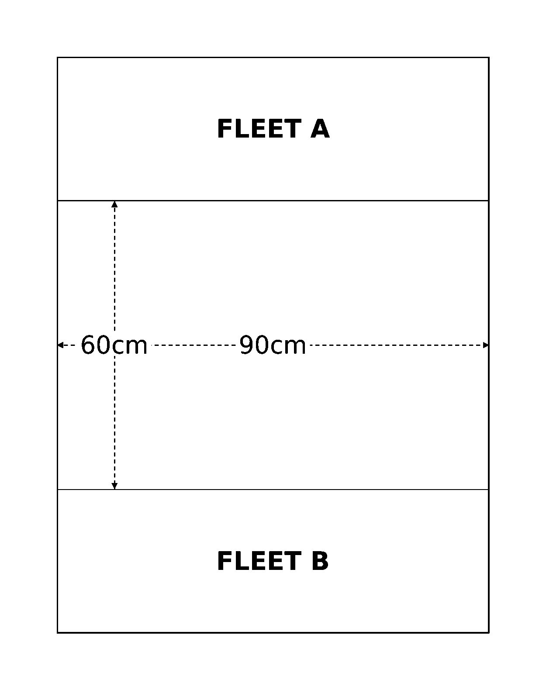

*Deployment diagram*

**First Turn.** Both players roll a dice. The player with the highest score may choose whether to have the first or second turn.

**Game Length.** The game lasts until the players have had eight complete turns each or until one fleet has all its ships destroyed.

**Victory Conditions.** Normal victory points are not used in this scenario. Instead, at the end of the game, each player scores 1 point for each point of damage they have inflicted on the enemy ships. A player scores an additional point for each crippled enemy ship, or 3 additional points for each destroyed enemy ship. For example, if an enemy ship suffers 5 points of damage this earns the opposing player 5 points and an additional point because the ship has been crippled. Note that you only receive 3 additional points for destroyed ships, you do not also get the single point for the ship having been crippled before it was destroyed. The player who scores the most victory points is the winner.

**A Note on Introductory Games:** For your first few games, you will probably want to avoid most of the content in the Advanced Rules section of the rulebook, at least until you feel comfortable commanding your fleet. Moreover, we recommend that you limit the amount of attack craft that both sides bring to the battle, as too much ordnance can be overwhelming for new players. Indeed, the ordnance phase can become a game unto itself when fleets' launch capacity gets large enough. Once you are ready for additional complexity, take a look at the Alternatives below or any of the other introductory scenarios in this book.

### Cruiser Clash - Alternatives

*Source: BFG:XR Rulebook, printed p.85.*

After playing this scenario a few times, you can try any of the following to introduce some additional complexity to your games:

**Forces.** You may remove the restriction on the maximum points value of the cruisers, which means that players will be able to take cruisers with nova cannons and other fancy weapons. Alternatively, you could allow each player one cruiser with special weapons in their fleet, or some other similar restriction. Refer to players' fleet lists for the points values of different cruisers. Furthermore, you may allow any number of cruisers up to an agreed points limit using the players' normal fleet lists. A good size to start with is 750 points, or 1,000 points if you want to include fleet commanders in your game. Fleet commander options available to a player are given at the start of their fleet list.

**Battlezone.** Once you are used to moving and shooting with your ships over an open table, try placing celestial phenomena on the tabletop. Start with gas and dust clouds first, and after playing with those a couple of times, try adding a planet or some asteroid fields as well. If players feel ready to expand on this, you may use the full celestial phenomena rules. If you do, roll a D6, on a score of a 1, 2 or 3 the battle takes place in the outer reaches; on a score of 4, 5 or 6 the battle is fought in deep space. See the Celestial Phenomena section for more details.

**Set-up.** You may like to use the Set-up rules for the Fleet Engagement scenario instead of simply pointing your ships at each other.

**Victory Conditions.** Rather than adding up damage points, try using the victory points system in the introduction to the Scenarios section.

**Advanced Rules.** Once you are familiar with the basic Battlefleet Gothic rules, you should begin using some of the Advanced Rules (source: rulebook p.36). In particular you may like to try using the rules for ramming, disengaging, and boarding actions.

## The Bait

*Source: BFG:XR Rulebook, printed p.86.*

A lone ship has been sent into a system to lure out the defending forces in an extended pursuit. Unknown to the pursuers, the fleeing vessel has some friends lying in wait up ahead. This is a good introductory scenario for learning about asymmetric starting forces.

**Forces.** This scenario works with forces worth up to 750 points. These are divided as shown below: Pursuing forces (Attacker): up to 500 points. Pursued forces (Defender): one ship or squadron worth up to 250 points initially, with up to 500 points of reinforcements.

**Battlezone.** The battle will take place in the outer reaches or deep space. Use any standard method to determine the battlezone, or roll a D6: on a score of 1-3, the battle takes place in the outer reaches; otherwise, it takes place in deep space.

**Set-up.** The pursued vessel is placed in the center of the table first, facing one of the short table edges. The pursuers are deployed more than 60cm away behind it. Reinforcements for the pursued ship enter from the table edge in front of it.

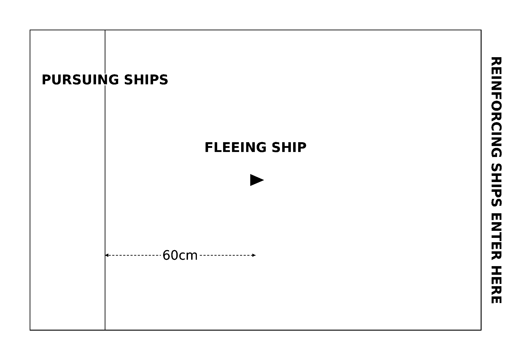

*Deployment diagram*

**First Turn.** The defender (who controls the fleeing ship or squadron) takes the first turn.

**Special Rules.** Any reinforcements for the fleeing ship(s) may enter the table on any turn, including Turn 1. If the reinforcing ships enter after Turn 1, they may be deployed up to 30cm along one of the long table edges for each turn after the first (as measured from their short table edge). For example, a Slaughter class cruiser enters as reinforcements on Turn 4, so it may be placed on the defender's short table edge or up to 90cm away from it, along one of the long edges.

**Game Length.** The game continues until one fleet disengages or is destroyed.

**Victory Conditions.** The fleet with the highest victory point total at the end of the game wins.

**The Third Armageddon War:** If you are playing in a Third Armageddon War Campaign, you may use the variant scenario below called Parol's Bait, which represents Admiral Parol's desperate attempt to break up the overwhelming number of Ork ships descending on the Armageddon system.

### Parol's Bait (Variant Scenario)

*Source: BFG:XR Rulebook, printed p.87. Campaign-specific variant of The Bait, for the Third Armageddon War Campaign.*

As the massive tidal wave of Ork ships spread throughout the Armageddon system, Admiral Parol was forced to disengage his ships from front line combat or run the risk of having his fleet destroyed before he was able to mount any serious challenge. With direct battle out of the question, Parol dispersed his forces with orders to harry the Orks' flanks wherever possible. With most of the alien vessels only too willing to seek combat, Parol hoped that he could distract and possibly destroy enough of the enemy to delay their arrival around Armageddon itself. Many textbook naval stratagems were tested to their limits.

The Parol's Bait variant scenario uses all the same rules as Scenario Two (The Bait), with the following modifications:

**Forces.** In this scenario, a small group of Imperial Navy light cruisers and escorts have successfully drawn out a force of Ork ships from the main fleet and are leading them towards a trap. When playing the Parol's Bait scenario in a Third Armageddon War Campaign, the attacker plays as the Ork fleet, and the defender plays as the Imperial Navy. The pursued forces may only include light cruisers and escort squadrons, but more than one cruiser or squadron may start on the table (as fleeing ships). The Imperial Navy player may also purchase up to six orbital mines, which count against the 500 points of reinforcements (although they start on the table as normal, source: rulebook p.67).

**Battlezone.** Roll for the battlezone randomly. On a 1-4, this scenario takes place in the outer reaches. On a 5-6 it takes place in the primary biosphere. Generate celestial phenomena on the appropriate battlezone table.

**Set-up.** The scenario uses the same set-up rules as The Bait. Any orbital mines included by the Imperial Navy player must be placed between the fleeing ships and the short table edge in front of them.

**Victory Conditions.** Standard victory points are earned for ships crippled or destroyed. In addition, the Orks gain bonus victory points equal to half the value of any reinforcements brought on to help the pursued Imperial ships. If mines are taken, the victory points for these are automatically awarded to the attacker.

*Flavour text:* "Heroes of Armageddon! You have withstood the evil savagery of the Orks, and they have left nothing for you to fear. So raise high the black banners of vengeance, now is our time!", Commissar Yarrick, during the Third War for Armageddon

## Chance Encounter

*Source: BFG:XR Rulebook, printed p.88.*

An invading fleet led by a powerful, singular flagship heads towards a vital system to join its allies for an impending attack. Patrolling forces detect the fleet and quickly change course. Their only option is to stop or at least stall this advancing menace before it can reach an allied battle-zone. Will the defenders succeed in buying some precious time, or will these brave souls join the long list of those crushed before the invaders' mighty warfleet? This is a good introductory scenario for learning about larger battles with asymmetric victory conditions.

**Forces.** This scenario works best with a points limit between 750 and 1,000 points. The attacking force then receives an additional 250 points beyond the agreed limit.

\- *Invading Forces (Attacker):* The attacker must include one flagship and at least one cruiser. The flagship must have more than 12 starting hits or be worth at least 500 points. If the attacker's faction cannot meet this requirement, an Activated Blackstone Fortress may be used instead. The flagship must also embark a fleet commander (with Ld9 or better, if possible). Remaining forces may be chosen at the attacking player's discretion, but no battleships may be included (except the flagship, if it is one).

\- *Patrolling Forces (Defender):* The defender must include a single battlecruiser, grand cruiser, or heavy cruiser (or faction equivalent) as a flagship, and at least two other regular cruisers. The flagship must embark a fleet commander (with Ld9 or better, if possible). Remaining forces may be chosen at the defending player's discretion, but no battleships may be included.

**Battlezone.** This battle will either take place in the outer reaches or in deep space. You may use any of the usual methods to determine the battlezone, or you may roll a D6: on a score of 1-3, the battle takes place in the outer reaches; otherwise, it takes place in deep space.

**Set-up.** The attacker begins by placing their chosen flagship on the center line of their long table edge, 10cm in from the edge itself. Players then alternate placing one capital ship or escort squadron within their respective deployment zones until all models have been placed.

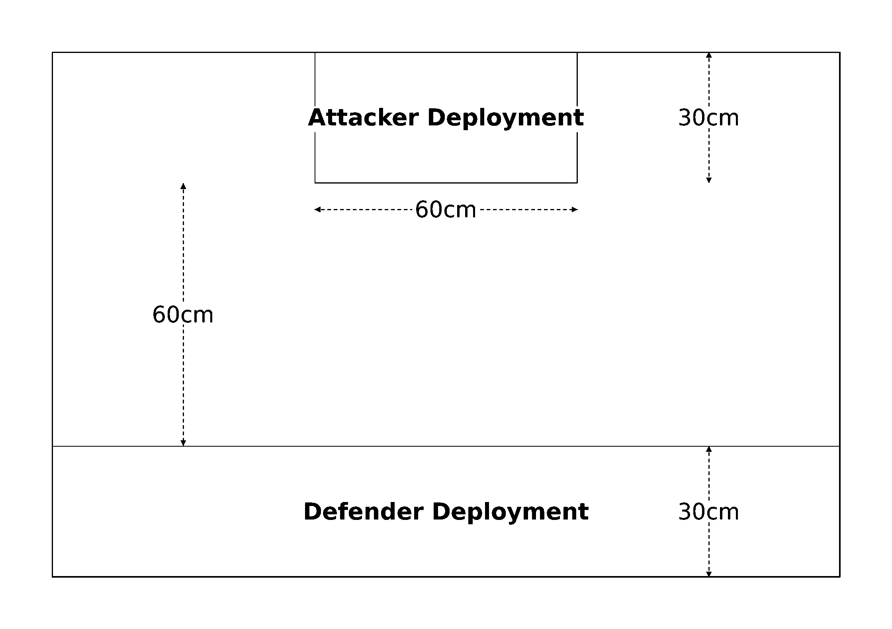

*Deployment diagram*

**First Turn.** The defender may choose whether to go first or second.

**Game Length.** The game lasts six turns, or until one fleet disengages or is destroyed.

**Victory Conditions.** All the defending forces can hope to do is slow the invading fleet and buy time for their allies to regroup. As a result, the defenders are considered victorious if the attacker's flagship is crippled before the end of the game. If the defenders manage to actually destroy the attacker's flagship, it is a heroic victory instead! If the attacking flagship and at least one other attacking capital ship disengage by moving off the defender's long table edge, the attacker is victorious (unless their flagship is crippled, of course).

## Abaddon's 13th Black Crusade

*Source: BFG:XR Rulebook, printed p.89. Campaign-specific scenario dressing, still grouped under Introductory Scenarios in the source.*

If you are playing in a 13th Black Crusade Campaign, this scenario may be used to represent the Planet Killer's approach towards Cadia. To do so, use the following forces:

**Chaos (Attacker):** The Planet Killer, a Devastation class cruiser, a Slaughter class cruiser, and one squadron of three Iconoclast class destroyers. The Planet Killer is commanded by a Chaos Warmaster.

**Imperial Navy (Defender):** A Mars class battlecruiser, a Tyrant class cruiser, a Gothic class cruiser, and one squadron of four Cobra class destroyers. The Mars class battlecruiser is commanded by a Fleet Admiral.

### Suggested Flagships

The following are some recommended flagship vessels for different factions to use with this scenario. This can be a good way to learn how to use some of the larger, centerpiece units in your chosen faction book.

| Faction | Suggested Flagship |
|---|---|
| Chaos Fleets | The Planet Killer or a Chaos Space Hulk |
| Ork Fleets | Ork Space Hulk |
| Tyranid Fleets | Proteus Class Hive Ship |
| Necron Fleets | Cairn Class Tomb Ship |
| Tau Empire Fleets | Kroot Warsphere (w/ extra hits added) |
| Eldar Fleets | Void Stalker or Wyrm Battleship (w/ refits) |
| Space Marine Fleets | Battle Barge (w/ refits) |
| Other Fleets | Activated Blackstone Fortress |

For an Imperial Navy or Space Marine fleet, you may also consider using the Ramilies Star Fort or Fortress-Monastery (respectively), replacing their rules for rotation with a 5cm move in any direction. Always make sure to check with your opponent before modifying the rules this way, however.

## Overview

*Source: BFG:XR Rulebook, printed p.90.*

The six scenarios presented in this section are referred to as raids. All raids share the common theme of a weaker attacking force launching a lightning strike on a larger defending force, taking advantage of a momentary vulnerability or fortuitous circumstance to hopefully tip the odds in their favor. Due to the inherent asymmetry in raid scenarios, these can be good choices when not all players have a full collection of miniatures ready for the table. Several raids also reward objective-based gameplay over direct engagements, ideal for players looking for more than a straight-up ship brawl.

*Flavour text:* "In my high seat I gaze into the immaterium and see the shadow that our own universe casts into depthlessness. This eye... this eye sees gentle flows of soul-stuff where the becalmed mind might starve to death, and tides and churns of genius and hate. The warp mocks the power of words to describe. But what I can never turn my back on is the power and the beauty of the Emperor. I see His soul shine out from Earth and His presence fill every corner of the immaterium. I am scorned for what I talk of seeing, scorned by my family, so be it. Some say that every one of us sees a face of the warp meant only for him, a warp that none other shall ever see, but it makes no matter. I have known from the first time I beheld it that I could do nothing but follow that light with my life.", Peshto Vask Zemlya, Navigator

## The Raiders

*Source: BFG:XR Rulebook, printed p.91.*

A small attacking force has been sent in to cripple or destroy as much of the enemy fleet as possible before they are destroyed themselves. If the attackers succeed, the defending fleet will be put out of operation for months, enabling the attacker's main fleet to roam the system unhindered.

**Forces.** Agree on a points limit for the battle. The defender may spend up to this points limit in total, while the attacker can spend up to half this amount.

**Battlezone.** The attack could take place anywhere from the flare region all the way to deep space. Use any of the methods on rulebook p.49 to determine the battlezone and any appropriate celestial phenomena.

**Set-up.** The defender deploys their whole fleet first. The defending fleet must be set up with all the ships facing the same table edge and at least 30cm from any table edge. Each defending ship or squadron must be set up at least 20cm apart. The attacker moves their fleet onto the table from any edge on their first turn.

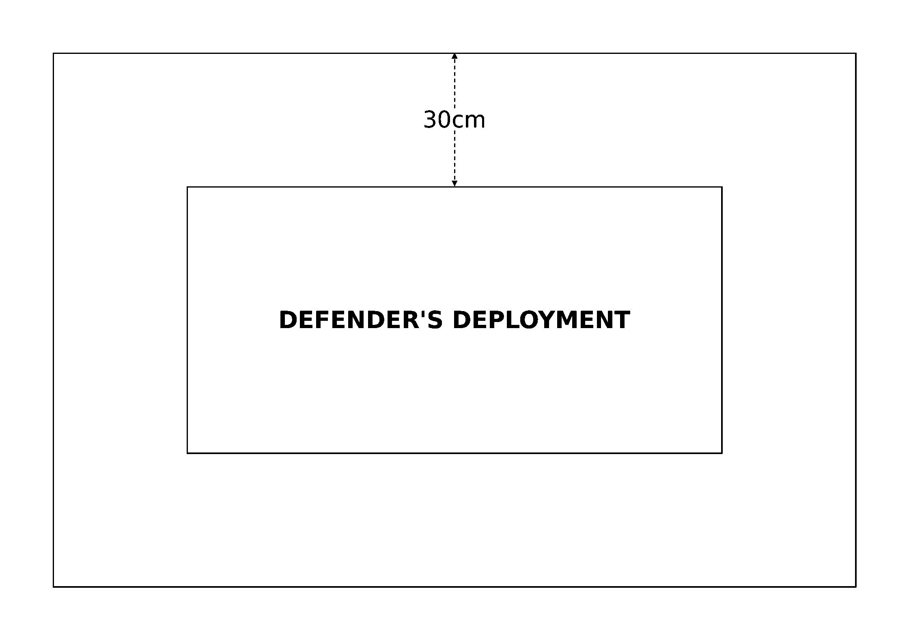

*Deployment diagram*

**First Turn.** The attacker takes the first turn and moves their fleet on from one table edge.

**Special Rules.** For the first D6 turns, all the defender's ships suffer a -1 Leadership penalty to represent their reduced state of alert.

**Game Length.** The game lasts eight turns, or until one fleet disengages or is destroyed.

**Victory Conditions.** Both fleets score victory points as normal, and the fleet with the highest victory points total at the end of the game wins. Note that this means it is possible for the attacker to be completely destroyed and still win the scenario!

## Blockade Run

*Source: BFG:XR Rulebook, printed p.92.*

A fleet has been trapped in the system for several months, unable to fight past the enemy fleet blockading the jump point. A small attack force has been assembled to break through the blockade at its weakest point, to hopefully return with sufficient reinforcements to lift the blockade totally.

**Forces.** Agree on a points limit for the battle. The blockading player (the defender) may spend up to this many points on their fleet. The attacker (attempting to break the blockade) may spend up to half this total on their fleet.

**Battlezone.** The blockading force is stationed at the edge of the system, so the battle will take place in either the outer reaches or deep space. You may use any of the usual methods to determine the battlezone, or you may roll a D6: on a score of 1-3, the battle takes place in the outer reaches; otherwise, it takes place in deep space.

**Set-up.** Divide the table lengthwise into thirds as shown below. The blockading player then sets up their fleet. Roll a D6 for each blockading ship or squadron to determine the area in which it must be deployed. Blockading ships may start facing in any direction, but may not be placed within 60cm of the attacker's table edge. The attacker then sets up their force within 15cm of their table edge.

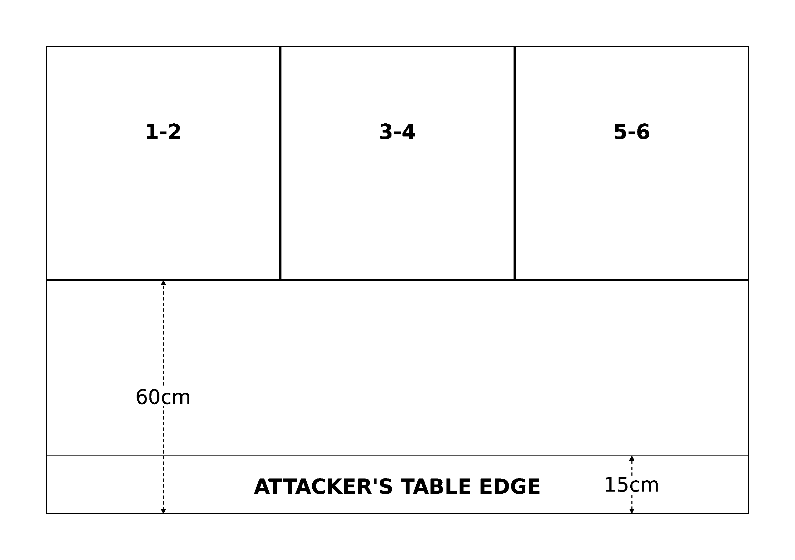

*Deployment diagram*

**First Turn.** Both players roll a D6. The player with the higher score may choose whether to go first or second. (Re-roll in the case of a tie).

**Game Length.** The game lasts six turns, or until one fleet disengages or is destroyed.

**Victory Conditions.** Both fleets score victory points as normal. In addition, the attacker scores bonus victory points for any vessels that he or she can move off the board (i.e. disengage) via the blockading player's table edge. Capital ships and escort squadrons that escape this way are worth 100% of their total points value if not crippled, otherwise they are only worth 25%. The side with the most victory points at the end of the game wins. Note that this means it is possible for the attacker to be completely destroyed and still win the scenario!

**Abaddon's 13th Black Crusade:** If you are playing in a 13th Black Crusade Campaign, you may use the variant scenario below called Daemon Blockade, which represents a fleet of Imperial Navy reinforcements attempting to reach the embattled Scelus and Belis Corona sectors before the region falls to Abaddon the Despoiler.

### Daemon Blockade (Variant Scenario)

*Source: BFG:XR Rulebook, printed p.93. Campaign-specific variant of Blockade Run, for the 13th Black Crusade Campaign.*

Reinforcements en route to the Belis Corona and Scelus sectors find themselves having to penetrate widespread Chaos blockades. This is risky business indeed, and many Admirals are forced to lead their ships as fast as possible through treacherous minefields and withering barrages of hostile firepower. Surprise is the only thing on their side. To make matters worse, there are reports that the Ruinous Powers have infused the enemy's orbital mines with daemonic abilities. This can only be a bad thing.

The Daemon Blockade variant scenario uses all the same rules as Scenario Two (Blockade Run), with the following modifications:

**Forces.** When using the Daemon Blockade scenario in a 13th Black Crusade Campaign, the attacker plays as one of the "Forces of Order" (the Imperial Navy, Adeptus Mechanicus, Space Marines, Inquisition, or Eldar), and the defender plays as the blockading Chaos fleet. The Chaos player may spend up to the agreed points limit, minus 100 points, on their fleet. In addition to this, he or she receives ten daemon mines for free, which follow the special rules defined below. The attacking player may spend up to half the agreed points limit on their fleet, as normal.

**Set-up.** The scenario uses the same set-up rules as Blockade Run. In addition, the Chaos player must place his or her daemon mines one at a time, rolling for their deployment zone just like other blockading ships and squadrons.

**Special Rules.** Daemon mines use the normal rules for mines as described on rulebook p.27, with the following exceptions: they move 10+D6cm in each ordnance phase; they have a 4+ resilient save against enemy fighters (working just like it does for attack craft); and they automatically destroy any enemy ordnance they encounter (except fighters), without being removed themselves.

**Victory Conditions.** The scenario uses the same victory conditions as Blockade Run. In addition, each daemon mine destroyed by the attacker before it contacts one of his or her vessels adds +10 victory points to his or her final total.

## Convoy

*Source: BFG:XR Rulebook, printed p.94-95.*

In this scenario, the defender must escort a convoy of vital transport vessels into a star system threatened by enemy forces. In order to catch the convoy, the attacking forces have seeded a wide area of space with ships lurking on minimal power to avoid detection, and clusters of "deadfall" torpedoes which will activate and launch as soon as an enemy ship registers on their sensors. But this convoy is desperately needed and must run the gauntlet of ships and missiles to deliver the supplies it carries.

**Forces.** Agree on a transport capacity requirement for the defender (minimum 2). The defending fleet's points limit is equal to half its transport capacity requirement (rounded down) × 100. Note that in this scenario, convoy ships must be arranged in squadrons of at least 2 vessels and/or 2 transport capacity. The attacker generates his or her forces randomly. Make two rolls on the table below, plus one additional roll for every 2 transport capacity in the defending fleet. Escort squadrons and capital ships are chosen from the attacker's fleet list. These are free from most restrictions (such as ratios of ships), but cannot exceed the fleet list's normal maximums for ship classes or sizes.

| D6 Roll | Result |
|---|---|
| 1 | One deadfall torpedo or attack craft cluster. |
| 2 | Two deadfall torpedo or attack craft clusters (in any mix desired). |
| 3 | Three deadfall torpedo or attack craft clusters (in any mix desired). |
| 4 | One squadron of escort ships worth up to 100 points. |
| 5 | One squadron of escort ships worth up to 150 points. |
| 6 | One capital ship worth up to 200 points. |

**Battlezone.** The attack could take place anywhere from the flare region all the way to deep space. Use any of the methods on rulebook p.49 to determine the battlezone and any appropriate celestial phenomena.

**Set-up.** The attacker sets up first, placing a face-down contact marker on the table for each capital ship, escort squadron, and deadfall torpedo or attack craft cluster in their fleet. Contact markers must be placed at least 30cm apart and may not be placed within 30cm of a table edge. If all of the counters cannot fit onto the table, start to double them up by placing an extra counter on top of each one already placed (and so on until all have been placed). The defender then rolls a D6 to determine the short table edge from which the convoy will move onto the board. He or she places one ship from the convoy at that edge of the table, at least 45cm from either long table edge, to mark the convoy's entry point.

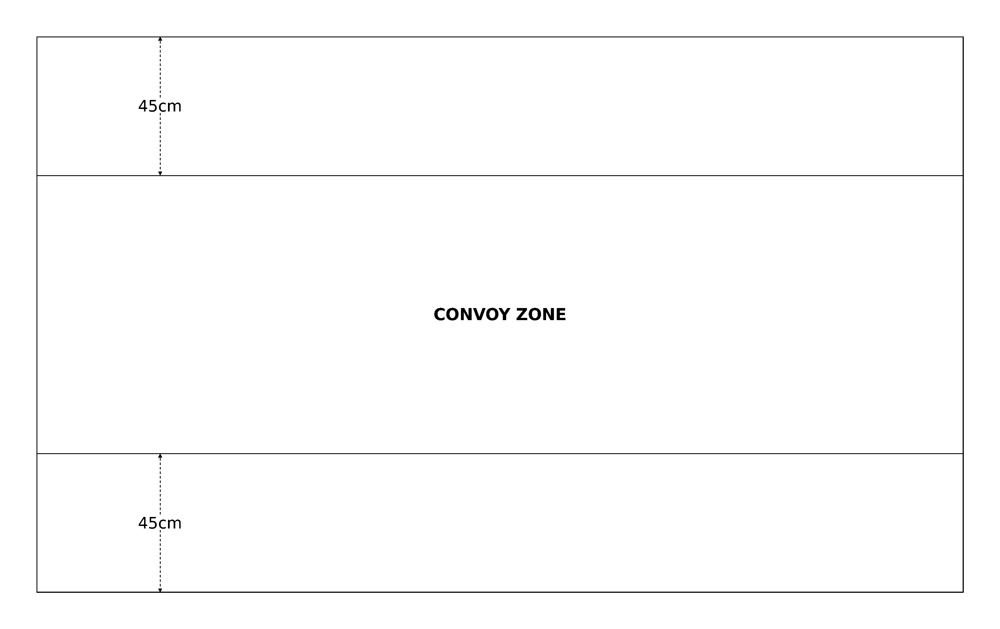

*Deployment diagram*

Contact markers represent the locations of the attacker's forces. Each must be unique to its corresponding ship, squadron, or torpedo/attack craft cluster, but should not be identifiable to the defender. Classically, Battlefleet Gothic uses triangular tokens (25×30mm) with numbers on one side.

A contact marker is activated as soon as a defending vessel moves within 30cm of it. Flip the marker face-up, then complete the defending ship's movement (if any). Once the defender's movement phase is finished, deploy the attacker's forces for each activated contact marker as described below:

**Deadfall Torpedoes:** Replace the contact marker with an ordinary torpedo salvo (Strength D6+2), oriented as desired by the attacking player. These have a speed of 30cm and begin moving in the next ordnance phase.

**Attack Craft:** Replace the contact marker with D3+1 squadrons of attack craft. These may be any mix of standard fighters, bombers, and/or assault boats, and may be combined into waves as desired by the attacking player. The attack craft begin moving in the next ordnance phase.

**Ship Squadron:** Place one ship from the squadron on top of the contact marker. The rest of the squadron is placed in formation with the first ship, no closer to the enemy than the first placed vessel. The squadron may be deployed facing any direction as desired by the attacking player, but all members must be oriented the same way.

**Capital Ship:** Place the capital ship on top of the contact marker, facing in any direction the attacking player chooses.

In addition, the attacking player may voluntarily activate one contact marker at the start of his or her movement phase, plus an additional marker if the defender has any ships on special orders, to represent the attacking fleet detecting the approaching convoy. Deploy the forces for these markers immediately, using the rules described above.

**First Turn.** The defender takes the first turn. Each ship in the convoy moves onto the table from the point indicated. If desired, the defender may hold back up to half of his or her fleet's ships, which must move onto the table from the same entry point on his or her second turn.

**Game Length.** The game continues until the defender has no convoy ships left on the board.

**Victory Conditions.** The success or failure of the convoy depends on the total transport capacity of the convoy ships that move off the short table edge opposite the defender's entry point (rounding down). Only convoy ships that disengage in this manner count for victory purposes.

| Transport Capacity Escaped | Game Result |
|---|---|
| None | **Attackers Win.** |
| One | **Attackers Marginal Win.** |
| Two | **Convoy Marginal Win.** |
| Three or More | **Convoy Win.** |

Note that if the attacking fleet disengages or is destroyed (with no remaining ships, deadfall torpedoes, or attack craft available), and at least one point of transport capacity has escaped or is still on the table, the game ends immediately and the defender is automatically victorious.

**The Third Armageddon War:** If you are playing in a Third Armageddon War Campaign, you may use the variant scenario below called The Gauntlet, which represents a fleet of Imperial transport ships making a desperate run through Ork-infested space, in order to deliver critical supplies to the besieged worlds of the Armageddon Sector.

### The Gauntlet (Variant Scenario)

*Source: BFG:XR Rulebook, printed p.96. Campaign-specific variant of Convoy, for the Third Armageddon War Campaign.*

The ferocity and speed with which Ghazghkull's "Waaagh!" assailed the Armageddon sector left many worlds isolated, and left much of the Imperial Navy scattered. To ensure the sector did not become entirely strangled by the invading greenskins, many hundreds of daring convoy runs had to be made directly through Ork held space...

The Gauntlet variant scenario uses all the same rules as Scenario Three (Convoy), with the following modifications:

**Forces.** When using the Gauntlet scenario in a Third Armageddon War Campaign, the attacker plays as the Orks, and the defender plays as the Imperial Navy. The Imperial player chooses their fleet normally, except that he or she must take at least 3 transport capacity worth of convoy ships (rather than 2), and may only take escorts, light cruisers, and up to one standard cruiser. No battle-cruisers, grand cruisers, heavy cruisers, or battleships may be taken. The Ork player chooses any number of escorts (in valid squadrons), up to a points limit equal to half the defender's transport capacity (rounding up) × 100.

**Set-up.** The Imperial convoy and escorting fleet are placed within 45cm of one short table edge, facing the opposite edge. The Orks do not deploy, and will instead move onto the table during their first turn.

**First Turn.** The Ork player takes the first turn, moving all of his or her ships onto the table from any point(s) along either long table edge. A different entry point may be chosen for each attacking squadron as desired.

**Victory Conditions.** The scenario uses the same victory conditions as the Convoy scenario, except that the Imperial player must have at least 3 transport capacity escape in order to claim victory, rather than the usual 2.

**Running Battle (Optional):** As this is a running battle, representing an Imperial fleet desperately trying to get their convoy to safety, you might like to try the following special rule when playing this scenario:

- *Set-Up:* The Imperial convoy and escorting ships are all placed within 30cm of the center of the table at the start of the game, facing either short table edge. The Ork ships move on from any point along either long table edge in the first turn as normal.

- *Special Rules:* At the end of every Imperial turn, every ship and item of celestial phenomena is moved back 20cm, away from the table edge the Imperial ships were facing at the start of the game. Any ship that "drops" off the end of the table during this shift is considered to have disengaged from the battle. In addition, roll a die at the end of the Imperial player's turn. On a 6, a randomly generated item of celestial phenomena is placed by the Imperial player along the short table edge that his or her ships originally faced, representing the Imperial commander leading the convoy (and the battle) towards any celestial phenomena that will give them an advantage on their mission. Always ignore any rolls that would generate a planet, after all, Armageddon is still many thousands of kilometers away!

- *Game Length:* In this variation of The Gauntlet, the game lasts for ten turns.

- *Victory Conditions:* If the Imperial player still has at least 3 transport capacity on the table at the end of the game, they may claim victory.

## Rearguard Attack

*Source: BFG:XR Rulebook, printed p.97.*

Forces sector wide have been split up into smaller patrols and sent in to cripple or destroy as much of an enemy's rearguard as possible before they are destroyed themselves. The targeted hostile forces are experiencing radar malfunctions due to the presence of jammer mines scattered in their way. The time to strike is now. If the attacker can cause enough damage, then these rearguard fleets will be rendered temporarily ineffective, buying the systems ahead some time to organize their defenses. The odds are stacked against them, but stealth may just triumph over numerical superiority.

**Forces.** Agree on a points limit for the battle. The defender may spend up to this limit on their fleet, but must split at least 25% of its point value off as reinforcements. The attacker may only spend up to half the agreed points limit on their fleet.

**Battlezone.** The attack could take place anywhere from the flare region all the way to deep space. Use any of the methods on rulebook p.49 to determine the battlezone and any appropriate celestial phenomena.

**Set-up.** Only the defender deploys their fleet. They must set up with all the ships facing the sunward table edge and at least 30cm from any long table edge and 60cm from the sunward table edge. Each defending ship or squadron must be set up at least 10cm away from all other defending ships or squadrons.

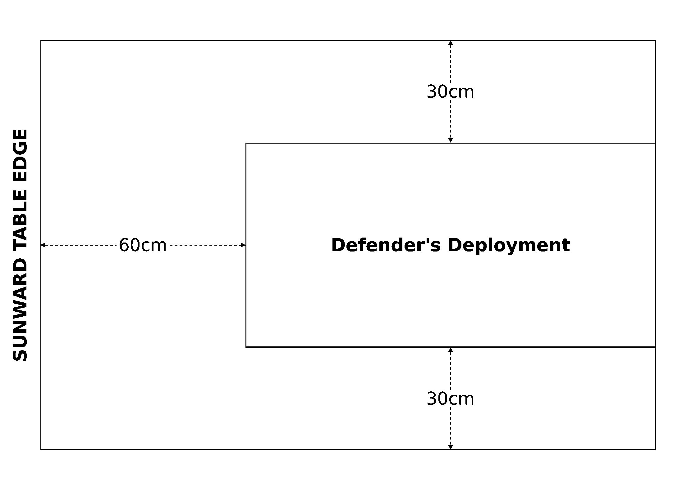

*Deployment diagram*

**First Turn.** The attacker takes the first turn, moving their fleet onto the table from any table edge(s) of their choice.

**Special Rules.** For the first D6 turns, all the defender's ships suffer a -1 Leadership penalty to represent their reduced state of alert. Any reinforcements for the defender may enter the table from the sunward table edge on any turn, including Turn 1. If the reinforcing ships enter after Turn 1, they may be deployed up to 30cm along one of the long table edges for each turn after the first (as measured from the sunward table edge). For example, a Slaughter class cruiser enters as reinforcements on Turn 4, so it may be placed on the sunward table edge or up to 90cm away from it, along one of the long edges.

**Game Length.** The game lasts eight turns, or until one fleet disengages or is destroyed.

**Victory Conditions.** Both fleets score victory points as normal, and the fleet with the highest victory points total at the end of the game wins.

**Abaddon's 13th Black Crusade:** If you are playing this scenario in a 13th Black Crusade Campaign, the Forces of Order will be the attackers, and the Forces of Disorder will be the defenders.

## Navigate the Storm

*Source: BFG:XR Rulebook, printed p.98.*

Warp Storms have ravaged several sectors, making travel through them difficult at best, and in many cases impossible. Many warp rifts have opened up along transport channels as a result of these storms. These vital channels have been rendered doubly dangerous by the disturbing fact that the arriving enemy fleets have found a way to use the warp rifts to their advantage. The transports must continue to deliver their important cargo on time and so convoy escort fleets have doubled in size to repel any would-be attackers.

**Forces.** The attacking player may spend up to 750 points on their fleet. The defending player may spend up to 1000 points on their fleet, and must take 10 transport capacity worth of convoy ships to represent the convoy their fleet is escorting through the storm.

**Battlezone.** Instead of using the normal battlezone rules, players take turns placing 8 warp rifts each, starting with the attacking player. Each warp rift must be at least 10cm from any other warp rift. Do not place any other celestial phenomena.

**Set-up.** Both players secretly set up their fleets in their respective deployment zones. You may use any suitable method to accomplish this, such as dividing the board with a tall screen or having players first privately sketch their ships' positions then deploy to match.

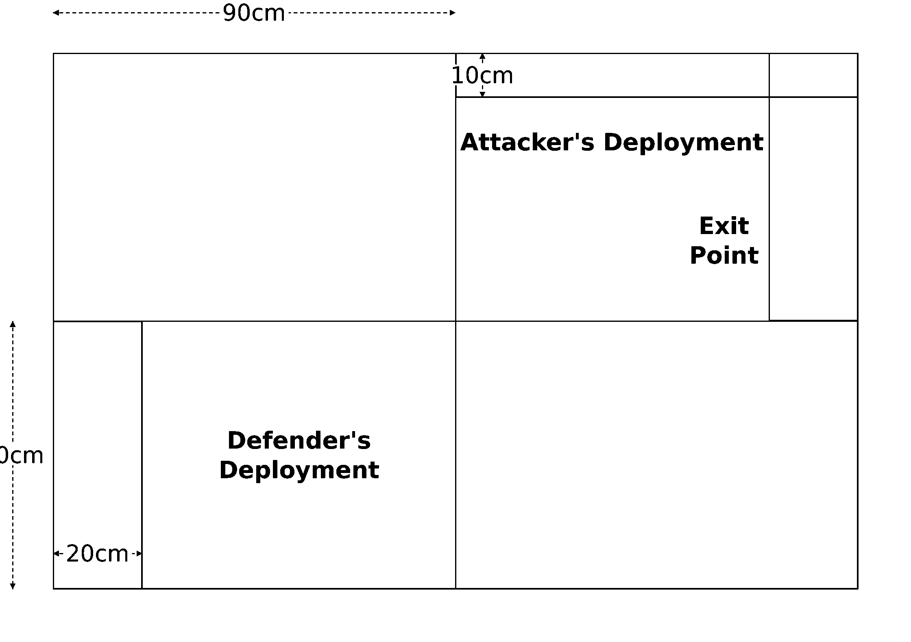

*Deployment zones and the exit point*

**First Turn.** The attacker chooses whether to go first or second.

**Special Rules.** If an attacking ship fails to navigate a warp rift, it is not lost forever. Instead, during the attacker's end phase, they must do the following for each of their ships lost in the warp: choose a friendly or enemy capital ship already on the table and roll a D6. On a result of 2+, place the "lost" ship anywhere within 20cm of the target, facing any direction. Otherwise, the "lost" ship remains in the warp for another turn. Ships that arrive this way are materializing, they take no damage, do not interact with anything on the table, and can do nothing except move and turn. At the end of the attacker's movement phase, each materializing ship that is not in base contact with an enemy vessel returns to normal and must take a leadership test. If the test is failed, the ship's armaments function at half-strength until the end of the turn.

**Game Length.** The game lasts until victory conditions are met, or no transport capacity remains in play.

**Victory Conditions.** The attacking player needs to destroy at least 8 transport capacity worth of enemy ships and score at least 50% of the defending fleet's point value in victory points. Ships lost in warp rifts count towards this total, but those that evacuate via the exit point do not. The defending player needs to move at least 5 transport capacity and 25% of their fleet (by point total, ignoring crippled ships and squadrons) off the table via the exit point (see the deployment diagram). Otherwise, the player that destroyed or evacuated the most transports is the winner. If the players' totals are equal, the attacker wins.

*Flavour text:* Every servant has his place, no matter how lowly or modest. To know it is his greatest comfort, to excel within it is his greatest solace, and his master's contentment is his greatest reward.

**Abaddon's 13th Black Crusade:** If you are playing this scenario in a 13th Black Crusade Campaign, Chaos is the attacker and the Imperium is the defender. In this case, any Chaos ships that are lost in the warp are permanently transformed into daemonships (for the rest of the campaign), and must arrive via Warp Translation in the Chaos player's end phase rather than use the special rules of the scenario.

## Destroy the Docks

*Source: BFG:XR Rulebook, printed p.99.*

A massive influx of enemy reinforcements are making their way to the orbital docks of a strategically vital system. Although this regrouping effort cannot be stopped, it can be hindered. A raid on the shipyards and resupply stations around the planet could stall the enemy fleet's momentum if the attack goes well, as the infrastructure will need to be repaired by the foe before they can move on. A small fleet has been dispatched to strike at the vulnerable orbital satellites and cause as much havoc as possible before further hostile reinforcements arrive.

**Forces.** The attacking player may spend up to 1500 points on their fleet, then must divide it into two forces with points values as equal as possible. The defender may only spend up to 750 points on their fleet, and cannot include any battleships. In exchange, the defender gains one fleet commander re-roll for free, along with 2 Space Stations, 1 Orbital Dock, 8 Orbital Mines, 1 Defense Monitor, and 2 System Escorts at no additional cost (source: rulebook p.65-67). The defender also chooses (separately from their fleet) eight of the following satellites in any mix desired: Orbital Weapons Platform, Orbital Defense Laser Platform, or Orbital Torpedo Launcher. These must be divided into two groups of four, referred to as the inner platforms and outer platforms respectively.

**Battlezone.** Instead of using the normal battlezone rules, place a large planet in the center of the table. Both players (starting with the attacker) then place an asteroid field anywhere outside the planet's gravity well (30cm from the marker's edge).

**Set-up.** The defending player starts by placing the orbital dock and two space stations anywhere within the planet's gravity well. Then, the defender places the outer platforms anywhere on the table (they do not need to be within a gravity well). The attacker then deploys one of their two forces within 10cm of a short table edge and deploys the other force within 10cm of the opposite table edge. The defender now places the inner platforms, system escorts, defense monitor, and orbital mines anywhere within the planet's gravity well. The remainder of the defender's forces are held in reserve and will arrive later.

**First Turn.** The attacker rolls 2D6 and the defender rolls 1D6. The player with the highest result chooses whether to go first or second.

**Special Rules.** The defender's reinforcements arrive at random. Roll a D6 for each ship and squadron in reserve at the start of the defender's turn and consult the chart below. For every two turns that a particular ship or squadron fails this roll, add a cumulative +1 modifier to all subsequent arrival rolls it makes.

| Slowest Speed | 20cm or less | 21-29cm | 30cm+ |
|---|---|---|---|
| Arrives on a result of... | 5+ | 4+ | 3+ |

Arriving reinforcements enter play from the table edge shown in the diagram below.

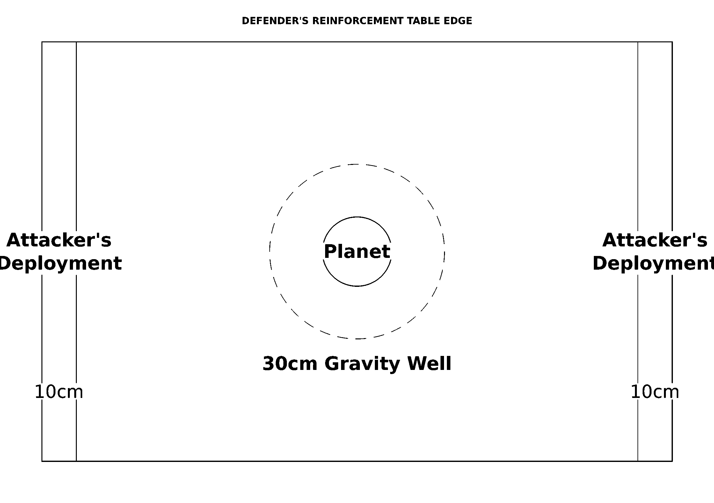

*Reinforcement edge, gravity well and attacker's deployment*

**Game Length.** The game lasts for eight turns or until the attacking fleet has completely disengaged or been destroyed.

**Victory Conditions.** In order to win, the attacker must destroy both space stations, the orbital dock, all of the inner platforms, and at least 25% of the defender's reinforcement fleet (by point value). Otherwise, the defender wins.

**Abaddon's 13th Black Crusade:** If you are playing in a 13th Black Crusade Campaign, this scenario may be used to represent the Chaos raid on Belis Corona (known as Above Belis Corona in previous editions of Battlefleet Gothic). In this case, the Forces of Disorder will be the attackers and the Forces of Order will be the defenders.

## Overview

*Source: BFG:XR Rulebook, printed p.100.*

This next section presents six scenarios designed to represent more conventional fleet battles. While the introductory scenarios and raids can also be played at higher points limits, these battle scenarios are configured with larger fleets in mind. Many of these battles will take place near planets with ample defensive forces of their own, giving players an opportunity to field their collections of orbital satellites, deadly mine fields, and imposing space fortresses. Additionally, some battles may even involve descending into low orbit where ships must contend against the inexorable pull of gravity or be smashed upon the planet's surface!

## Exterminatus!

*Source: BFG:XR Rulebook, printed p.101-102.*

Sometimes, an enemy poses a threat so grave and so immediate that there can be only one solution: the utter annihilation of a world, accomplished through an unparalleled act of destruction known in the Imperium as Exterminatus. In this scenario, the attacking fleet is escorting a group of Exterminators, ships capable of laying waste to entire planetary populations or even obliterating all life on a world in a matter of hours. The defenders must stop this Exterminator fleet at all costs, and will rush every ship in the vicinity to protect their threatened planet.

**Forces.** Agree on a points limit for the battle. *Attacker:* may spend up to the agreed limit on their fleet. For every 1,000 points (or portion thereof), the attacking player may nominate one of their capital ships to be an Exterminator, granting that ship an Armageddon weapon (replacing the ship's prow armament, if any). Alternatively, the attacking fleet may include a single Activated Blackstone Fortress as its Exterminator instead of refitting any capital ships (subject to the normal cost and restrictions in the General Fleet Support List; source: rulebook p.75). *Defender:* may spend up to the agreed limit on their fleet, plus an additional D6×10 points on planetary defenses for every 500 points (or portion thereof) in their fleet. Keep in mind that the defender may also spend up to one third of their fleet's points on planetary defenses (source: rulebook p.65).

**Battlezone.** The defender determines whether the battle is fought in the primary or inner biosphere. Place a planet (D6: 1 = small, 2-5 = medium, 6 = large) no more than 150cm from any short table edge, as shown below. Use any method on rulebook p.49 to place additional celestial phenomena.

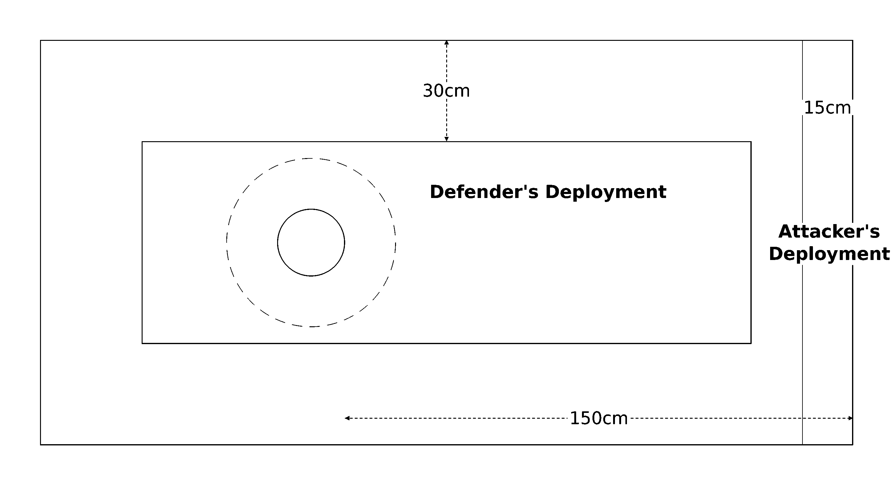

*Planet placement and deployment zones*

**Set-up.** The defender has most of their fleet stationed near the planet, but several ships or squadrons are out on patrol and will arrive later. The defender must choose one capital ship or escort squadron to be away on patrol for every 500 points (or portion thereof) in their fleet. Set the chosen ships aside. The remainder of the defender's fleet may then be deployed anywhere on the table further than 30cm from a table edge. The attacker then sets up their entire fleet within 15cm of the short table edge furthest from the planet. Note: a separate low-orbit table is needed for this scenario (source: rulebook p.54).

**First Turn.** Each player rolls a D6. The player with the higher score chooses whether to go first or second.

**Special Rules.** The Exterminator(s) must enter low orbit to attack the planet. At the start of each turn that an Exterminator is within 45cm of the planet table edge, roll a D6. On a result of 4+ the ship successfully deploys its Armageddon weapon, destroying the planet! As a result of this threat, defending ships may always treat Exterminators as the closest enemy for the purpose of target priority. The defender's patrols arrive at random. Roll a D6 for each ship and squadron away on patrol at the start of the defender's turn and consult the chart below. Arriving patrols move onto the board from a random table edge, determined as shown below.

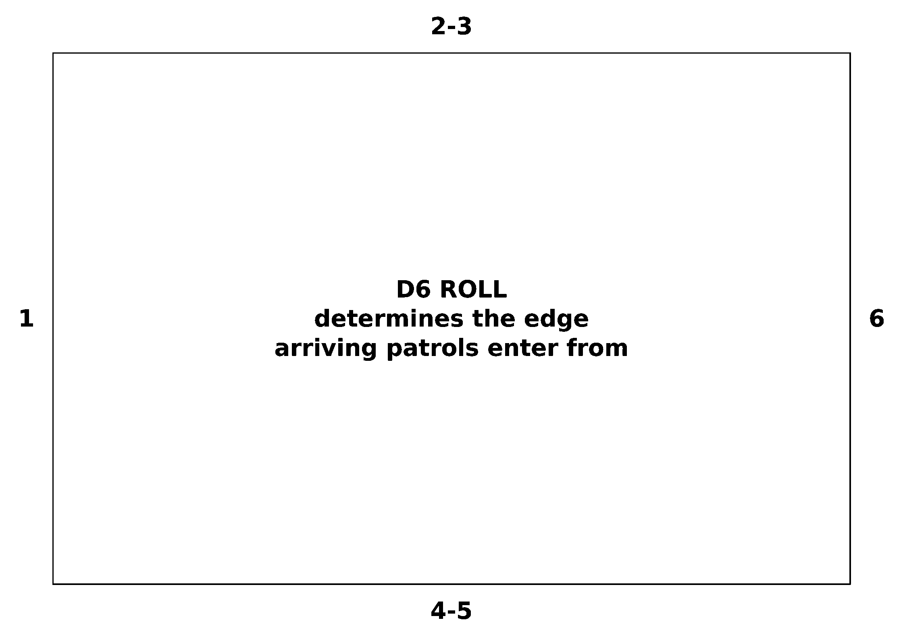

*Random arrival edge by D6 roll*

| Slowest Speed | 20cm or less | 21-29cm | 30cm+ |
|---|---|---|---|
| Arrives on a result of... | 5+ | 4+ | 3+ |

**Game Length.** The game lasts until the planet or all Exterminators are destroyed, or when one fleet disengages or is destroyed in its entirety.

**Victory Conditions.** If the planet is destroyed, the attacker wins. If all Exterminators are destroyed, the defender wins. Otherwise, whichever fleet holds the field at the end of the game is the winner. If you are playing in a campaign and the planet is destroyed, make a roll on the table below to determine the long-term consequences of the lost planet:

| D6 Roll | Result |
|---|---|
| 1-3 | The system becomes uninhabited. Mark it as such on the subsector map. |
| 4-6 | The system's primary world is destroyed but one or more other planets still bear life. Roll a D6 to see what the system's new primary planet is: 1-3 = agri-world, 4-6 = mining planet. |

*Note: If you are interested in playing out the ground portion of a planetary assault through a game of Warhammer 40,000 and/or Epic 40,000, each assault point is worth 2000 and 400 points, respectively (see the Planetary Assault scenario below for assault points). This ratio will create some truly impressive battles, but feel free to use a smaller one where appropriate for the players' collections.*

*Flavour text:* Heresy is like a tree, its roots lie in the darkness whilst its leaves wave in the sun and to those who suspect nought, it has an attractive and pleasing appearance. Truly, you can prune away its branches, or even cut the tree to the ground, but it will grow up again ever the stronger and ever more comely. Yet all awhile the root grows thick and black, gnawing at the bitter soil, drawing its nourishment from the darkness, and growing even greater and more deeply entrenched. Such is the nature of heresy, and this is why it is so hard to destroy, for it must be eradicated leaf, branch, trunk and root. It must be exorcised utterly or it will return all the stronger, time and time again, until it is too great to destroy. Then we are doomed., *Prelude to The Abominatus*

*Flavour text:* "We have arrived, and it is now that we perform our charge. In fealty to the God Emperor, our undying lord, and by the grace of the Golden Throne, I declare Exterminatus upon the Imperial world of Typhon Primaris. I hereby sign the death warrant of an entire world, and consign a million souls to oblivion. May Imperial justice account in all balance. The Emperor protects.", Last transmission before the destruction of Typhon Primaris

## Alien Intervention

*Source: BFG:XR Rulebook, printed p.103.*

A hostile fleet thought to have abandoned the sector is instead found raiding a space hulk orbiting a nearby world. When this news reaches allied fleet command, a force is quickly gathered in an attempt to surprise the enemy and crush them. Unfortunately, the reconnaissance group was spotted by the enemy raiders. Now, allied forces have fallen into a trap and all seems to be in favor of the ruthless pillagers aligned against them. That is until sensors begin picking up traces of nearby alien warships...

**Forces.** Agree on a points limit for the battle. The attacker may spend up to this limit on their fleet. The defender may spend up to 75% of the agreed points limit on their fleet, and up to 25% of the agreed limit on a separate fleet of allies of convenience chosen from a different faction (this fleet is entirely separate, built using its own fleet list). This fleet can also be controlled by a third player, if desired.

**Battlezone.** The attack could take place anywhere from the flare region all the way to deep space. Use any of the methods on rulebook p.49 to determine the battlezone and any appropriate celestial phenomena. In addition, you must include one planet and one drifting hulk (source: rulebook p.24; you may use any capital ship to represent the hulk) anywhere within 30cm of the table's center.

**Set-up.** First, the defender deploys their entire fleet within 30cm of the table's center line, as shown below. Each defending ship or squadron must be set up at least 10cm apart and facing in the same direction. The attacker then deploys their fleet anywhere within 20cm of either short table edge (divided in any way the attacker chooses).

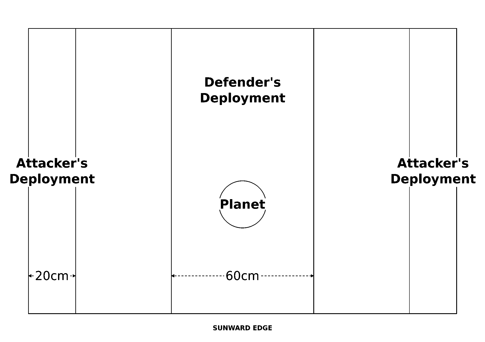

*Deployment diagram*

**First Turn.** The attacker rolls 2D6 and the defender rolls 1D6. The player with the highest total chooses whether to go first or second.

**Special Rules.** The defender's "alien reinforcements" are fickle, and will arrive randomly. Roll a D6 at the start of the defender's 2nd turn onward and consult the chart below. When the reinforcements arrive, the entire fleet enters from the long table edge of the controlling player's choice.

| Turn Number | 2 | 3 | 4 | 5 | 6 |
|---|---|---|---|---|---|
| Alien fleet arrives on... | 4+ | 3+ | 2+ | 2+ | Auto |

**Game Length.** The game lasts eight turns, or until one side disengages or is destroyed.

**Victory Conditions.** Both fleets score victory points as normal, and the fleet with the highest victory points total at the end of the game wins. Note that all ships and squadrons from the "alien reinforcements" fleet are counted as part of the defender's forces for the purpose of scoring victory points.

*Flavour text:* Trust not in their appearance, for the Eldar are as alien to good, honest men as the vile Tyranids and savage Orks. There is no understanding them for there is nothing to understand, they are a random force in the universe.

**Abaddon's 13th Black Crusade:** If you are playing this scenario in a 13th Black Crusade Campaign, the Forces of Disorder are the attackers and the Forces of Order are the defenders, and the Eldar Corsairs represent the alien reinforcements.

## Surprise Attack

*Source: BFG:XR Rulebook, printed p.104.*

The attacking fleet has launched a preemptive strike against their foe, catching the enemy unawares while its vessels are still taking on stores in dock over a nearby planet. The attacker's aim is simple: decimate the vulnerable opposing fleet before it can deploy and regroup. With most of their ships powered down on standby, the defenders must try to muster a response as quickly as possible before they are destroyed piecemeal by the approaching force.

**Forces.** Agree on a points limit for the battle. Both players may spend up to this limit on their fleets. In addition, the defender may spend an extra D6×10 points on planetary defenses for every 500 points (or portion thereof) in their fleet.

**Battlezone.** The attack takes place in the primary or inner biosphere (defender's choice). Set up a planet in the middle of the table. The planet's size depends on the size of the battle: up to 500pts = small, 501-1500pts = medium, 1501pts or more = large. Use any method on rulebook p.49 to place additional celestial phenomena as desired.

**Set-up.** First, the defender must choose D3 ships or squadrons in their fleet to be on full alert. These ships may be deployed anywhere on the table at least 30cm from a table edge. The rest of the defending fleet is on standby. Ships and squadrons on standby must be deployed within 15cm of the planet, with all ships abeam of the planet's surface, as shown below. The attacking fleet does not deploy; it will move onto the table during the first turn.

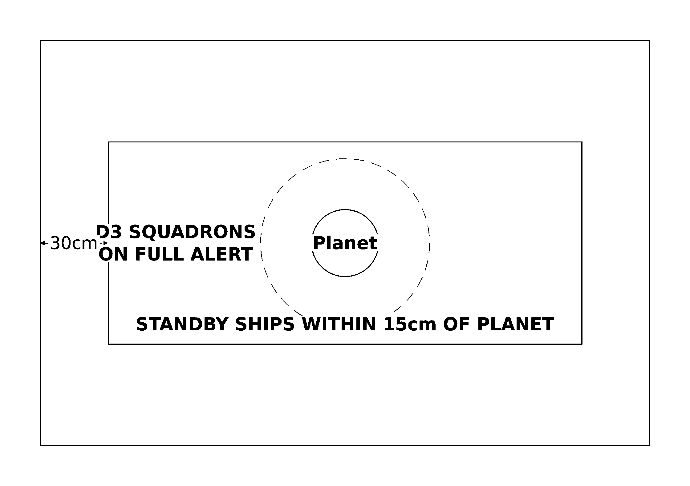

*Full-alert and standby deployment*

**First Turn.** The attacker goes first, choosing a table edge and moving their entire fleet onto the table from anywhere along that edge.

**Special Rules.** Ships and squadrons on standby may not move, shoot, launch ordnance, board, or make teleport attacks. However, they may attempt Brace for Impact orders, repair critical damage, and use their turrets against enemy ordnance. At the start of the defender's turn, each ship or squadron on standby may take a leadership test. Each ship or squadron that succeeds goes on full alert and may act normally, though it cannot use any special orders on that turn.

**Game Length.** The game lasts until one fleet disengages or is destroyed.

**Victory Conditions.** Both fleets score victory points as normal, and the fleet with the highest victory points total at the end of the game wins.

## Planetary Assault

*Source: BFG:XR Rulebook, printed p.105-106.*

Although fleet engagements are vital to every war effort, the undeniable reality is that in the absence of an Exterminatus order, ground battles will ultimately determine who controls a system's resources and strategic position. To facilitate this, an attacking fleet will often be tasked with deploying troops onto the surface of a contested planet, either to spearhead an invasion or reinforce existing armies. Doing this will not be easy however; they must smash through enemy defenders and hold off any counterattack while the troop transports make their landing.

**Forces.** Agree on a points limit for the battle. Both players may spend up to this limit on their fleets. In addition, for every 500 points (or portion thereof) in the players' fleets, the attacker must take 2 transport capacity worth of convoy ships while the defender may spend an extra D6×10 points on planetary defenses.

**Battlezone.** The defender determines whether the battle is fought in the primary or inner biosphere. Place a planet (D6: 1 = small, 2-5 = medium, 6 = large) no more than 150cm from any short table edge, as shown below. Use any method on rulebook p.49 to place additional celestial phenomena.

*Planet placement and deployment zones*

**Set-up.** First, the defender must choose which ships and squadrons in their fleet are on patrol or on alert. Those on alert must be deployed within the planet's gravity well. For each ship or squadron on patrol, roll a D6. On a result of 1-3, that ship or squadron is placed by the attacker. Otherwise, it is placed by the defender. Ships on patrol must be deployed at least 30cm from a table edge, not within an area of celestial phenomena, and facing a direction of the defender's choice (regardless of who placed them). The attacker then sets up their entire fleet within 15cm of the short table edge furthest from the planet. Note: a separate low-orbit table is needed for this scenario (source: rulebook p.54).

**First Turn.** Each player rolls a D6. The player with the higher score chooses whether to go first or second.

**Special Rules.** At the start of the attacker's shooting phase, they may direct any of their capital ships and/or convoy vessels within 30cm of the planet table edge (excluding those that are in the process of boarding or being boarded) to assault the planet rather than fight normally. Ships attacking the planet must focus all their efforts on doing so and thus cannot shoot, launch ordnance, or make teleport attacks for the rest of the turn. For each ship that assaults the planet, the attacker scores a number of assault points equal to twice that ship's transport capacity. All capital ships are treated as having a point of transport capacity at a minimum for this purpose, unless otherwise specified.

Escort-sized convoy ships that land on the planet (source: rulebook p.54) may score on the same turn they do so (as if they were within 30cm of the planet table edge), but not on any subsequent turns. Furthermore, the defender will still score victory points for ships that disengage this way. Keep in mind that this scoring method is only for escort-sized vessels, capital ships cannot land!

**Game Length.** The game lasts until the attacker scores 10 or more assault points, or one fleet disengages or is destroyed.

**Victory Conditions.** Tally up the attacker's total assault points, adding +1 for every full 500 victory points they earned and deducting -1 for every 500 victory points (or portion thereof) earned by the defender. If the attacker holds the field, each attacking capital ship and convoy ship on the table (not counting crippled ships) scores one final time (as described above). Look up the total result below:

| Total | Result |
|---|---|
| 0-1 | **Defender's Victory.** |
| 2-5 | **Defender's Marginal Win.** |
| 6-9 | **Attacker's Marginal Win.** |
| 10+ | **Attacker's Victory.** |

*Note: If you are interested in playing out the ground portion of a planetary assault through a game of Warhammer 40,000 and/or Epic 40,000, each assault point is worth 2000 and 400 points, respectively. (This ratio will create some truly impressive battles, but feel free to use a smaller one where appropriate for the players' collections.)*

*Flavour text:* "When the people forget their duty they are no longer human and become something less than beasts. They have no place in the bosom of humanity nor in the heart of the Emperor. Let them die and be forgotten.", Leto Barbaden, Governor of Salinas

## Escalating Engagement

*Source: BFG:XR Rulebook, printed p.107.*

Any tactician worth their salt knows that the only thing worse than disregarding battlefield intelligence is assuming that it is infallible. As such, it is wise for a fleet traversing contested space to proceed with caution, lest it find itself suddenly outmaneuvered and out-gunned. In this scenario, two opposing fleets are in the area, each unsure of the enemy's size and disposition. As they split to spread their search wider, two groups come into contact and signal the rest of their forces. Whose ships will arrive first? Will they be able to overcome the enemy? Only time will tell...

**Forces.** Agree on a points limit for the battle. Both players may spend up to this limit on their fleets. Each player then gathers five contact markers (25×30mm triangular tokens with numbers on one side work best) and divides their fleet into divisions, each corresponding to one of their contact markers. Note which forces are assigned to each marker. There are no restrictions as to what ships can be in a division, but each division must have at least one ship or squadron assigned to it. Once a division moves onto the table, its ships may move normally; they are not constrained to stay together like a squadron.

**Battlezone.** The attack could take place anywhere from the flare region all the way to deep space. Use any of the methods on rulebook p.49 to determine the battlezone and any appropriate celestial phenomena.

**Set-up.** Both players must randomly select one contact marker (without showing their opponent the division it represents). These will be the players' starting forces. Each player then rolls a D6. The player with the higher score chooses whether to place their marker first or second. Contact markers may be placed anywhere on the table at least 30cm from the table edge and at least 60cm from an enemy contact marker. Once both markers have been placed, reveal the divisions they represent. The players then deploy those divisions' forces anywhere within 10cm of their respective markers, starting with whoever placed their contact marker last.

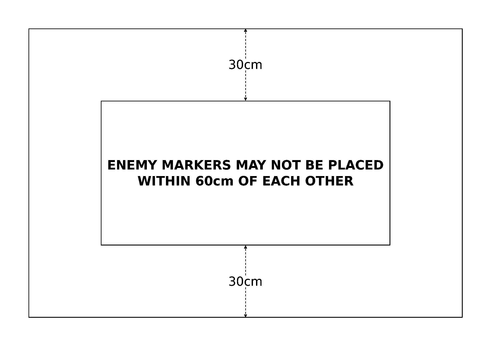

*Deployment diagram*

**First Turn.** Each player rolls a D6. The player with the higher score chooses whether to go first or second.

**Special Rules.** In the end phase of each player's turn, that player randomly selects another one of their contact markers (again without showing their opponent the division it represents) and places it along a randomly rolled table edge according to the following restrictions: the marker cannot be placed within 60cm of any enemy ships; if there are friendly ships within 30cm of that table edge, the marker must be placed within 30cm of at least one of those ships.

At the beginning of a player's turn, that player may try to bring additional ships into play by rolling a D6 for any of their contact markers already placed on a table edge and consulting the chart below:

| Slowest Speed | Division arrives on\* |
|---|---|
| 20cm or less | 5+ |
| 21-29cm | 4+ |
| 30cm+ | 3+ |

*If friendly ships are within 30cm of the contact marker, add +2 to the dice roll.*

If the division arrives successfully, each of its ships and squadrons must move onto the table from anywhere along the marker's table edge that is within 10cm of the marker. Then remove that division's contact marker from the game. Otherwise, the player may move that contact marker in either direction along its table edge, up to a distance equal to the speed of the slowest ship in the division.

**Game Length.** The game lasts until one fleet disengages or is destroyed.

**Victory Conditions.** Both fleets score victory points as normal, and the fleet with the highest victory points total at the end of the game wins.

## Fleet Engagement

*Source: BFG:XR Rulebook, printed p.108-109.*

While the majority of void-based conflicts in an interstellar war are fought by relatively small forces with specific objectives, it is inevitable that sometimes a direct engagement is the only means to protect a system, hold back a hostile advance, or simply crush all enemy resistance. These types of battles are often both tactically and strategically decisive; failure to defeat one's foe in such a large-scale showdown usually means extensive loss of territory, resources, or fighting strength, and may even spell the doom of the entire war effort.

**Forces.** Agree on a points limit for the battle. Both players may spend up to this limit on their fleets. For this scenario, ignore the usual rules for determining the attacker and defender, this will be decided by the set-up rules instead.

**Battlezone.** The attack could take place anywhere from the flare region all the way to deep space. Use any of the methods on rulebook p.49 to determine the battlezone and any appropriate celestial phenomena.

**Set-up.** Each player secretly chooses one of the following formations for their fleet and writes it down. Reveal the opposing fleet's formations simultaneously and then compare the two formations on the table below to determine the attacker and defender, as well as which battle set-up to use.

**Sphere:** This formation attempts to spread the fleet so that it envelops the enemy, surrounding it as the sphere closes in. It is vulnerable to the wedge formation however, which can break through the closing net.

**Wedge:** This formation keeps the fleet closely packed together for mutual support and allows it to storm through thinly-spread opponents. However, it offers no flexibility against the cross formation.

**Cross:** This formation spreads its ships out to run parallel with the enemy fleet, keeping them abeam for an extended engagement. The cross may be engulfed by the sphere formation, however.

| Your Choice \\ Opponent's Choice | Sphere | Wedge | Cross |
|---|---|---|---|
| **Sphere** | B | A (Atk) / C (Atk) | A (Atk) / D (Atk) |
| **Wedge** | A (Def) / C (Def) | D (Atk) / D (Def) | B |
| **Cross** | A (Def) / D (Def) | B | B |

Where the table shows two possible results (e.g. "A (Atk) / C (Atk)"), each player must roll a D6 and apply the following modifiers:

| The Fleet With the... | Adds |
|---|---|
| Fastest ship (by Speed characteristic) | +1 |
| Best commander (by Ld characteristic) | +1 |
| Most escorts | +1 |

The player with the higher score chooses which of the two set-up diagrams to use (A to D, below). Note that the choosing player always uses the formation comparison that applies to their own fleet. For example, if the choosing player is using the wedge formation and their opponent is using sphere formation, they will be the defender in their choice of either set-up A or set-up C. Alternatively, if both players are using the wedge formation, the choosing player decides whether they will be the attacker or the defender in set-up D.

Once the proper set-up configuration has been determined, both players roll a further D6. Starting with whoever rolled the lowest, players alternate placing one ship or squadron in their respective deployment zones until all forces have been placed. The players' deployments are also subject to the following rules:

**Divisions:** Some set-ups may split a fleet's deployment zone into several divisions. When this happens, the fleet must deploy at least one ship or squadron in each available division.

**Approach Angle:** Each set-up diagram has arrows indicating the approach angles for the opposing fleets. As ships are deployed, they must be oriented so that they are facing in the same direction as the arrow in their division.

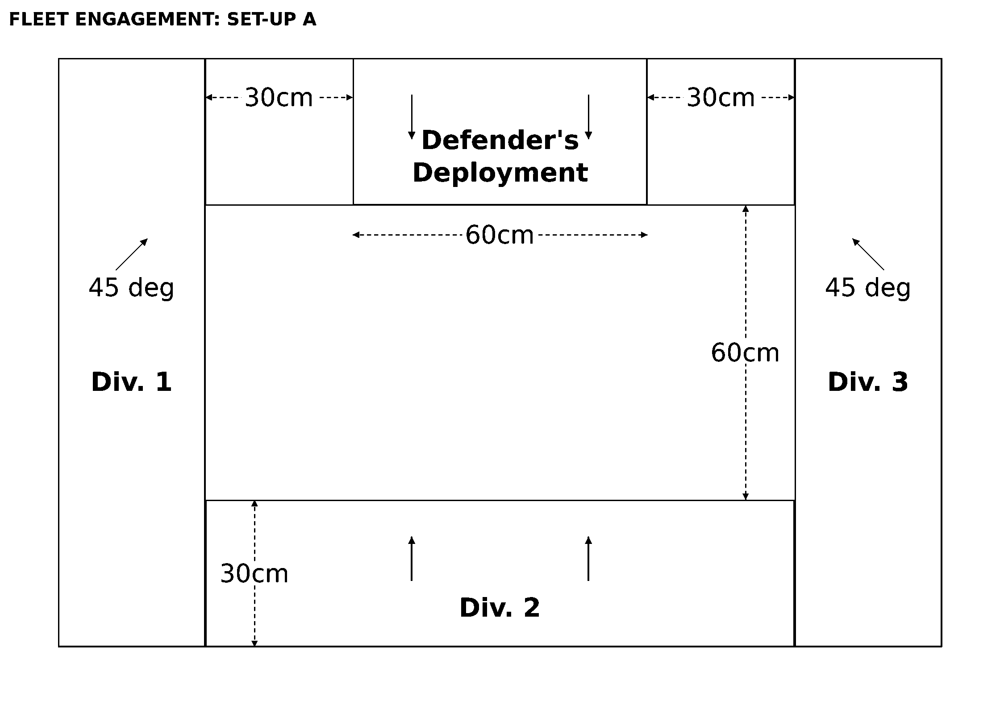

*Set-up A*

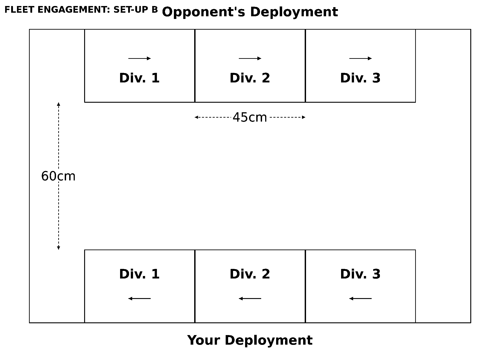

*Set-up B*

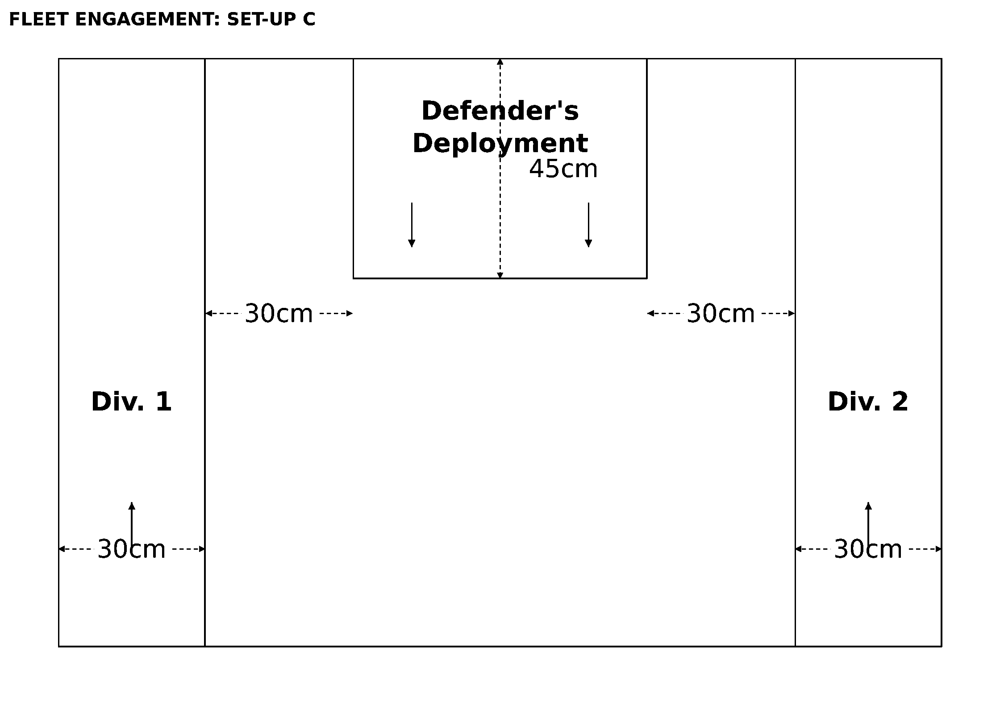

*Set-up C*

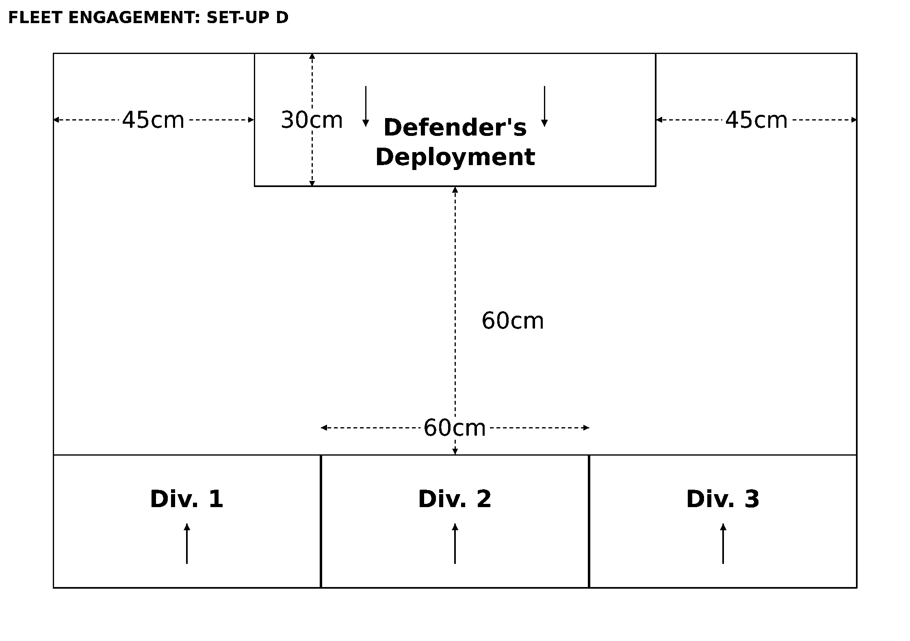

*Set-up D*

**First Turn.** Each player rolls a D6. The player with the higher score chooses whether to go first or second.

**Game Length.** The game lasts until one fleet disengages or is destroyed.

**Victory Conditions.** Both fleets score victory points as normal, and the fleet with the highest victory points total at the end of the game wins.

*Flavour text:* I have seen with mine own eyes many long and terrible wars. I have met brave men and good men whose deaths have weighed heavily upon my soul. On Anathasia I was witness to the Conquests of Zhar and the burning ruins of Ramnion haunt me still. On Badab I watched as the Tyrant's own fortress fell in dark ruin after so many years of unholy war. Even then I was not glad, for too many had fallen who were needed elsewhere. Too many lives extinguished whilst our enemies grew ever more powerful. Yet in all my many years I have never seen a sight as terrible as that great battle at the Gates of Athan. That horde of Chaos came on as a sea of blood that stretched from horizon to horizon without end. Over it hung a stink of death, a black cloud of evil which tainted the sky with its obscenity. I cannot think of it still without terror, and must endure a moment's panic to write even these few words. Even so, the Eldar did not flinch but stood their ground with a determination that exceeded human resolve as the strength of steel outmatches mortal flesh. And that was when I witnessed for the first and only time the strange secret of that race, seeing then what few humans have seen, the thing beyond human comprehension, the great daemon that is the Avatar of the Eldar., Historicus Ostalan Varus

## Overview

*Source: BFG:XR Rulebook, printed p.110.*

This section of the book features three special scenarios, each representing a singularly climactic battle where the fate of an entire world hangs in the balance. The first two serve as the grand finales of the Third Armageddon War and Abaddon's 13th Black Crusade campaigns, respectively, while the third is a truly unique experience. These have been separated from the standard raids and battles due to requiring more elaborate set-ups and/or larger forces than normal. As a result, choosing to play any of these scenarios is something you should discuss with your opponent, in the same way as any of the introductory scenarios.

*Flavour text:* "We fight the long war, not through vain notions of duty and honour, but through a far purer purpose: hatred. At the height of our glory we were betrayed and cast out by our kin. Guilliman, Dorn, Sanguinius, these are names I curse. Horus, Perturabo, Angron, these are names I revere, names I would follow to the very end. It is this hatred that has sustained me through the long millennia. I tend it with bitterness. I nurture it with the deaths of my former brothers. For I know that when the end is upon us and Horus is returned, then the false emperor shall be cast down from his sepulchral Golden Throne, and we shall take our rightful place at the side of Horus, the true Emperor of Mankind.", Ferrous Ironclaw, Iron Warriors Warsmith, 2nd Grand Company

## The Defense of Pelucidar

*Source: BFG:XR Rulebook, printed p.111. Grand-finale scenario for the Third Armageddon War Campaign.*

The initial elements of Ghazghkull's fleet entered the Armageddon system on the Day of the Feast of the Emperor's Ascension, a time when the Imperial Navy was building up to full alert status. Admiral Parol knew that time was of the essence as the forces of the Imperium marshaled their strength on Armageddon itself and that it would be the task of his fleet to buy this valuable time in the face of an immense Ork fleet. The Defence of Pelucidar was actually a huge engagement and so this scenario concentrates on only a small portion of the battle. The Imperial player, representing Admiral Parol, must cause as much damage as possible to the Ork fleet whilst trying to minimize his own losses. Initially, the Ork fleet will be poorly organized, but their strength will soon increase and threaten to overwhelm the Imperial force.

**Forces.** The battle takes place between the defending Imperial Navy and the attacking Orks, at the end of the Third Armageddon War. The Imperial player may spend up to 1500 points on their fleet, but may only include cruisers, battlecruisers, and battleships (no grand cruisers, light cruisers, or escorts), as well as up to four minefields at their normal cost. The Ork player starts with no ships or fleet, their forces will arrive at random throughout the battle (arriving ships always use their default profile; they do not get any refits).

**Battlezone.** The planet Pelucidar is located in the outer reaches of the Armageddon system. Generate any random celestial phenomena appropriate to the battlezone, then have the Imperial player place a medium planet (representing Pelucidar) anywhere on the table more than 5cm from a table edge.

**Set-up.** The defending Imperial fleet deploys first. Each defending ship and squadron must be set-up at least 30cm from any table edge, at least 20cm from another ship or squadron, and all facing directly towards the same table edge. The Ork player does not have any ships at this point and thus does not deploy anything.

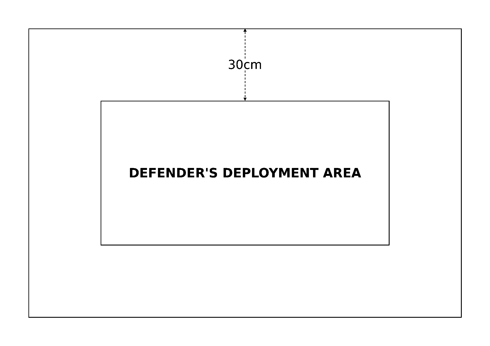

*Deployment diagram*

**First Turn.** The Orks always take the first turn.

**Special Rules.** At the start of each of their turns, the Ork player rolls on the chart below to determine what forces from Ghazghkull's fleet will arrive. The first few turns will go by quickly, but things will intensify rapidly as more and more Ork ships join the battle. If the Ork player rolls a result that they cannot field due to lack of models, use the next lowest result on the table instead. For example, if an 11 is rolled but the player has run out of capital ships, the Orks receive three squadrons of escorts instead.

| D6 + Turn Number | Forces |
|---|---|
| 2-4 | 1 Wave of 4 Squadrons of Fighta-Bommerz |
| 5-6 | 1 Squadron of D6 Escorts (in any combination desired) |
| 7-9 | 2 Squadrons of D6 Escorts each (in any combination desired) |
| 10 | 3 Squadrons of D6 Escorts each (in any combination desired) |
| 11 | 1 Kill-Kroozer, Terror Ship, or Basha Lite Kroozer |
| 12 | 2 Kill-Kroozers, Terror Ships, or Basha Lite Kroozers |
| 13-14 | 1 Hammer Class Battlekroozer or Ork Rok |
| 15+ | 1 Ork Space Hulk |

**Game Length.** The game lasts until the Imperial fleet disengages or is destroyed (it will continue even if there are no Ork ships on the board at the end of a turn).

**Victory Conditions.** Both fleets score victory points as normal, except that neither fleet counts as holding the field at the end of the game. If the Imperial fleet scores at least 2000 more victory points than the Orks, they win. Any other result is a triumph for the Orks.

## Macharia's End

*Source: BFG:XR Rulebook, printed p.112. Grand-finale scenario for Abaddon's 13th Black Crusade Campaign.*

The dreaded Planet Killer has managed to battle its way to the planet Macharia with the help of a sizable Chaos armada. If action is not taken immediately, the unthinkable will happen. Data gathered from previous victims of the Planet Killer indicate that its Armageddon gun takes a considerable amount of time to charge up before it is capable of destroying a planet. This means that there may still be enough time to thwart the Chaos fleet and save Macharia if swift Imperial vengeance is brought upon Abaddon's infernal machine.

**Forces.** This battle is fought between the defending Imperial Navy and an attacking Chaos armada at the conclusion of Abaddon's 13th Black Crusade. The Chaos player may spend up to 1500 points on their fleet in addition to including the Planet Killer at no cost. The Imperial player may spend up to 2000 points on their fleet, of which 500 points may be split off as the fleet's vanguard.

**Battlezone.** The battle takes place over Macharia, located in the system's primary biosphere. Place Macharia itself (a medium planet) in the center of the Imperial player's short table edge, as shown below. Randomly generate any other celestial phenomena appropriate to the battlezone.

**Set-up.** First, the Imperial player deploys their main fleet (without the vanguard) within 20cm of their short table edge (the same side as the planet Macharia). The Chaos player then sets up their whole fleet except the Planet Killer within 10cm of their short table edge (on the other side of the board). The Imperial player may then deploy their vanguard forces anywhere within 5cm of the centerline dividing the Imperial and Chaos sides of the table.

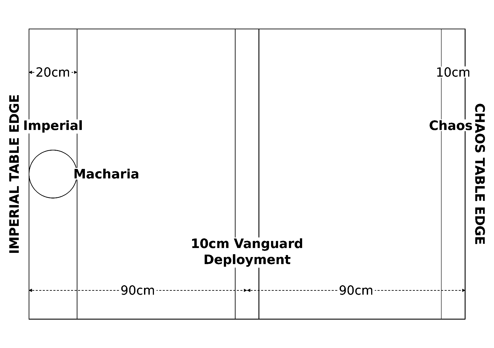

*Deployment diagram*

**First Turn.** The Imperial player takes the first turn. At the start of the first Chaos turn, the Planet Killer must move onto the board from the Chaos player's short table edge.

**Special Rules.** This scenario uses some additional special rules for the Planet Killer and its Armageddon Gun in conjunction with its rules found in the Chaos faction list.

**No Retreat:** Abaddon is committed to his course; if the Planet Killer would disengage, treat it as being destroyed instead.

**Armageddon Overcharge:** For this scenario, the Planet Killer needs to overcharge its main weapon in order to deal the deathblow to Macharia. While it can use this weapon normally if desired, it must overcharge the weapon in order to win the game. At the start of the Chaos player's turn, they may decide whether or not to begin the charge-up sequence for the Armageddon Gun. If they do, place a charge counter (such as a coin) next to the Planet Killer. Add another counter at the start of each subsequent Chaos turn. Once 3 counters have been accumulated the gun must fire during the Shooting Phase.

**While Overcharging the Gun:** The Planet Killer cannot turn, attempt special orders, or fire its lances while charging, but it gains an additional +2 shields. Once started, the charging process cannot be stopped.

**Firing the Overcharged Gun:** Place the Nova Cannon template so that it is touching the Planet Killer's stem, then move it directly ahead 60cm (just like firing it normally, but with shorter range). If any part of the template passes over any ship's base, that ship is completely destroyed. If the hole in the center of the template touches Macharia, the planet is obliterated and the game is over.

**Recharging:** If for some reason you manage to miss Macharia with the overcharged blast (how did you do that?!), the Planet Killer must pass two Reload Ordnance special orders across two consecutive turns to bring the weapon back online. During this time, it can do nothing except move (and attempt to Reload Ordnance).

**Game Length & Victory Conditions.** The game lasts until Chaos wins by destroying Macharia, or the Imperial Navy wins by crippling or destroying the Planet Killer.

## Craftworld Assault

*Source: BFG:XR Rulebook, printed p.113-115.*

A direct attack against an Eldar craftworld is exceedingly rare for a multitude of reasons, not the least of which is that they are astoundingly elusive prey despite their impressive size. Indeed, few non-Eldar can claim to have ever seen one in person. Nevertheless, when the Tyranid swarms of Hivefleet Kraken descended upon the galaxy, they did so in such numbers that the famed Craftworld Iyanden was forced into the path of the vast swarm and suddenly found itself facing the greatest peril of its long history.

**Forces.** This battle is fought between the defending Craftworld Eldar of Iyanden and any attacking force (canonically Tyranids). Agree on a points limit for the battle. Both players may spend up to this limit on their fleets. In addition, for every 500 points (or portion thereof) in the players' fleets, the attacker must take 2 transport capacity worth of convoy ships.

*Reserves:* Any number of ships or squadrons in the Eldar fleet may be purchased at 50% of their base cost. However, all ships and squadrons taken this way must start off the table as special reserves. These vessels will deploy later in the battle, via the Gates (below).

**Battlezone.** The attack could take place anywhere from the primary biosphere all the way to deep space. Randomly determine the battlezone using a D3, then use any of the methods on rulebook p.49 to determine appropriate celestial phenomena (ignoring any outcome that results in a planet). Finally, place the craftworld marker no more than 150cm from one of the short table edges.

### The Craftworld

In this scenario, a craftworld is the target of an attack in the same way a planet would be in the Planetary Assault scenario. The Tyranids of Hive Fleet Kraken targeted Iyanden, which is a fairly large craftworld (about 25cm in diameter). However, if you are playing this scenario with another craftworld as the target, or if you want to introduce some degree of randomness into the game, you can vary the size of the craftworld by rolling a D6:

| D6 | Size | Diameter | Gravity Well |
|---|---|---|---|
| 1 | Small | 10-15cm | 10cm |
| 2-5 | Medium | 16-20cm | 15cm |
| 6 | Large | 21-30cm | 20cm |

**Craftworld Iyanden:** For the purpose of game rules, a craftworld is a planet (and is represented by a planet marker of the appropriate size). This means they have their own gravity wells (as shown above), may use the low-orbit table, and so on. However, craftworlds never have moons or rings. Also note that while craftworlds are technically interstellar vessels, they move so remarkably slow that during a scenario the marker is treated as stationary in the same way as any other planet.

Unlike planets however, craftworlds do not have independent defenses. Instead, certain areas of the vessel are constructed with built-in combat and support systems. These are represented by the Fortresses, the Forges, the Gates, and the Spear of Light. The rules for these are below, and may be used to represent the standard defense configuration of any craftworld. In the case of Iyanden, these use the names shown in the craftworld layout diagram below.

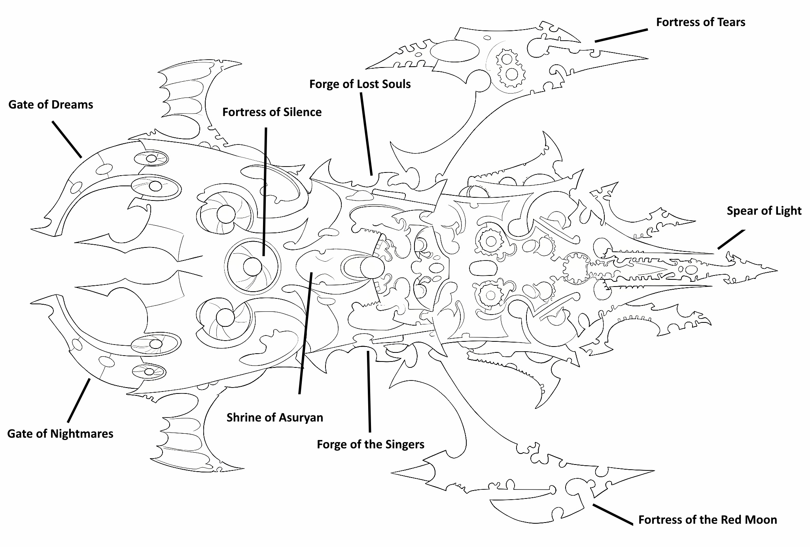

*Craftworld Iyanden: named fortresses, forges, gates and the Spear of Light*

*Flavour text:* They shall come, expecting the obvious, the simple, the artless. They shall stab at the shadows with confused minds and troubled hearts. Meanwhile, we shall appear unseen from ten directions, and from every one strike a fatal blow.

### The Fortresses

The two fortresses that flank the main body of the craftworld are designed to repel invaders from Iyanden by utilizing powerful but indirect plasma barrages to disrupt and scatter any enemy that manages to evade the craftworld's patrols.

Each time an assault point would be scored against the craftworld, roll a D6. On a result of 4+, the assault point is negated, the landing force was destroyed by interception fire from one of the fortresses.

In addition, the fortresses will fire directly upon approaching vessels. During the Eldar player's shooting phase, the two fortresses each unleash a Strength 1 pulsar lance attack against every enemy capital ship and escort squadron on the low-orbit table that is within 45cm of the planet table edge. Roll separately for each attack against each target.

However, the fortresses are not invincible. During each player's end phase, roll 1D6 per assault point already scored. If at least one result is a "6" the fortresses are damaged, mark a hit on a piece of paper or use a token of some kind. Use the table below to determine the effect(s) of damage on the fortresses. Keep in mind that the fortresses may only suffer a maximum of one damage per turn, no matter how many 6s are rolled in the end phase.

| Damage | Effect |
|---|---|
| 1 | No effect |
| 2-3 | Nullify assault points only on a result of 5+ |
| 4+ | Nullify assault points only on a result of 6+ |
| 5+ | One fortress is destroyed. It no longer makes attacks against targets on the low-orbit table. |
| 6+ | Both fortresses are destroyed. All benefits of the fortresses are lost. Do not roll for any further damage to them. |

### The Spear of Light

While the Spear of Light is essentially just another heavily-armed redoubt built to defend the craftworld, it is most renowned for its eponymous Spear of Light, a titanic linear accelerator capable of hurling plasma charges at high relativistic speeds. The device's primary purpose is to eliminate dangerous objects in the craftworld's path, such as large comets and recalcitrant moonlets. However, if the survival of the craftworld is at stake, it can be re-purposed as a terribly destructive weapon despite its limited accuracy (by Eldar standards).

The Spear of Light functions as a single Nova Cannon in all respects. As with the fortresses, roll 1D6 in each player's end phase for each assault point already scored. If at least one result is a "6" the Spear of Light is damaged. Use the table below to determine the effect. As before, it can only suffer a maximum of one damage per turn, no matter how many 6s are rolled.

| Damage | Effect |
|---|---|
| 1 | After firing the Spear of Light, the craftworld must use the Reload Ordnance special order (counting as Ld8) before the weapon can be fired again. |
| 2+ | The Spear of Light is destroyed and may no longer be used. Do not roll for any further damage to it. |

Note that the Spear of Light is used against targets at range and has no effect against vessels on the low-orbit table.

### The Forges

A craftworld's bonesingers have at their disposal the means to build and service an entire armada of Eldar vessels. Indeed, their fabrication techniques are so efficient, they can quite literally produce more starships than there are Eldar crews to man them. In an emergency, these forge docks may be outfitted to aid damaged vessels in the midst of battle.

Any Eldar capital ship in low orbit can dock with the craftworld by landing on the surface (in the same way that escorts and transports may land on a planet). To do so, simply move the ship into contact with the planet table edge, but do not remove it from the table. Instead, it remains docked in place until the end of the next Eldar turn. (Note that ships crashing into the surface due to the pull of gravity do not get to land, they are still destroyed as normal).

Docked Eldar capital ships add +4D6 to their roll to repair critical damage in the end phase (and ignore blast markers while repairing). Those without any repairable critical damage may also roll (including the preceding bonuses), and will recover 1 lost damage point for every result of 6. Additionally, docked Eldar ships automatically benefit from Reload Ordnance special orders and have the protection of the forges' netherfields and polarization fields (these are identical to those of the Haven Spire found in the Eldar faction list).

However, docked ships are unable to move, shoot, launch ordnance, board, or conduct teleport attacks, as this would obviously interfere with repair efforts.

### The Gates

Virtually all craftworlds have a series of webway portals scattered throughout their structure. The two largest of these are capable of opening portals tall and wide enough for an Eldar titan. Together, they create a single portal at the rear of the craftworld that can even accommodate starships.

At the beginning of each of their turns after the first, the Eldar player may roll a D6. On a score of 5+, the Eldar player chooses D3 capital ships and/or escort squadrons they have held in reserve and deploy them touching the craftworld planet marker and facing the closest short table edge. Eldar ships arriving from reserve cannot move or shoot in the same turn they appear.

### Set-up, First Turn, Special Rules, Game Length & Victory Conditions

*Source: BFG:XR Rulebook, printed p.115.*

**Set-up.** First, the Eldar player chooses which ships and squadrons in their fleet (besides those in reserve) are on patrol or on alert. Those on alert must be deployed within the craftworld's gravity well or on the low-orbit table. For each ship or squadron on patrol, roll a D6. On a result of 1-3, that ship or squadron is placed by the attacker. Otherwise, it is placed by the defender. Note that due to their nearly exclusive role as patrol ships, any escort squadron consisting entirely of Shadowhunter class destroyers must be set-up on patrol, but will always be deployed by the defender. Ships on patrol must be deployed at least 30cm from a table edge, not within an area of celestial phenomena, and facing a direction of the defender's choice (regardless of who placed them). The attacker then sets up their entire fleet within 15cm of the short table edge furthest from the planet.

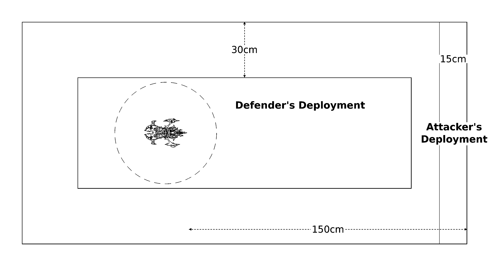

*Deployment diagram*

**First Turn.** Each player rolls a D6 and adds their fleet's attack rating to their result. The player with the higher total chooses whether to go first or second.

**Special Rules.** At the start of the attacker's shooting phase, they may direct any of their capital ships and/or transports within 30cm of the planet table edge (excluding those that are in the process of boarding or being boarded) to assault the craftworld rather than fight normally. Ships attacking the craftworld must focus all their efforts on doing so and thus cannot shoot, launch ordnance, or make teleport attacks for the rest of the turn. For each ship that assaults the craftworld, the attacker scores a number of assault points equal to twice that ship's transport capacity. All capital ships are treated as having a point of transport capacity at a minimum for this purpose, unless otherwise specified. Escort-sized convoy ships that land on the craftworld (source: rulebook p.54) may score on the same turn they do so (as if they were within 30cm of the planet table edge), but not on any subsequent turns. Furthermore, the defender will still score victory points for ships that disengage this way. Keep in mind that this scoring method is only for escort-sized vessels, capital ships cannot land!

**Game Length.** The game lasts until the attacker scores 10 or more assault points, or one fleet disengages or is destroyed.

**Victory Conditions.** Tally up the attacker's total assault points, adding +1 for every full 500 victory points they earned and deducting -1 for every 500 victory points (or portion thereof) earned by the defender. If the attacker holds the field, each attacking capital ship and convoy ship on the table (not counting crippled ships) scores one final time (as described above). Look up the total result below:

| Total | Result |
|---|---|
| 0-1 | **Defender's Victory.** |
| 2-5 | **Defender's Marginal Win.** |
| 6-9 | **Attacker's Marginal Win.** |
| 10+ | **Attacker's Victory.** |

## Overview

*Source: BFG:XR Rulebook, printed p.116.*

The nine scenarios presented in this section are faster, simpler versions of the narrative scenarios presented in the Raids and Battles sections. They have been designed with "pick-up" and "matched" play in mind, for clubs and tournaments where players are looking for a more balanced, competitive style of game. In particular, the Domination scenario is perhaps the most ideal for this purpose. These scenarios may also be useful for players looking to setup a gaming league with their friends and family. Finally, you should always feel free to use these scenarios in place of any narrative missions if your group finds them more enjoyable!

*Flavour text:* "Some say that perfection is the enemy of the good. They speak nonsense. Such apathetic thinking is what turns that which is good into bad. We should never cease our striving for greatness, never halt our purpose of bettering ourselves. Anything else is nothing but stagnation, and I have seen enough of the galaxy to know that to stagnate is to wither and die in shameful ignominy.", Shas'o Arra'kon

## Confrontation

*Source: BFG:XR Rulebook, printed p.117.*

The great ships of the Gothic Sector and beyond come together in a great clash among the stars. Each fleet brings the weight of their massive arsenals to bear in an all out conflict that will leave the void littered with the wreckage of once proud armadas. Thousands will perish and all that will remain is the laughter of thirsting gods.

**Forces.** Agree on a points limit for the battle. Both players may spend up to this limit on their fleets.

**Battlezone.** The attack could take place anywhere from the flare region all the way to deep space. Use any of the methods on rulebook p.49 to determine the battlezone and any appropriate celestial phenomena.

**Set-up.** The attacker chooses one of the long table edges and deploys their entire fleet anywhere within 30cm of it. The defender then deploys their fleet within 30cm of the opposite table edge.

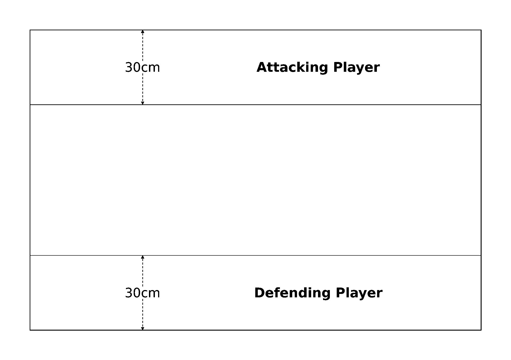

*Deployment diagram*

**First Turn.** The attacker takes the first turn.

**Game Length.** The game lasts until one fleet disengages or is destroyed.

**Victory Conditions.** Both fleets score victory points as normal, and the fleet with the highest victory point total at the end of the game wins.

*Flavour text:* "It was silent as the void, and to look upon it was to know terror. It drifted above us with slow, liquid grace, and its gaze caused madness and despair wherever it fell. Those it came near took their own lives rather than endure its hellish presence.", Morillia, Harlequin Shadowseer

## Line Breaker

*Source: BFG:XR Rulebook, printed p.118.*

Long range defense platforms have been set up at the edge of the system. These are the first line of defense against raiders and invasion forces alike. The attacking fleet must smash a hole in this blockade before it can move on to the interior of the system and wreak terrible havoc on the enemy's strategic positions. The defender will not make it easy, however; they have dispatched their own fleet in response to the threat.

**Forces.** Agree on a points limit for the battle. Both players may spend up to this limit on their fleets. The defender must include one defense platform for every 200 points (or portion thereof) in their fleet, counting its cost against their points total as normal. Each defense platform is represented by an orbital weapons platform, orbital defense laser platform, or orbital torpedo launcher (source: rulebook p.65-66). They cannot be formed into squadrons.

**Battlezone.** The attack takes place in the outer reaches. Use the appropriate table on rulebook p.51 to place celestial phenomena.

**Set-up.** The defender chooses one of the long table edges and sets up their fleet within 60cm of it. Defense platforms must be placed more than 30cm from any table edge, more than 15cm from each other, and not within any celestial phenomena. Note that they do not need to be placed within a planet's gravity well. The attacker then sets up his or her fleet within 15cm of the opposite long table edge.

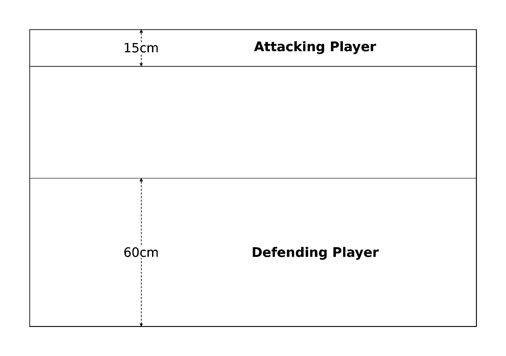

*Deployment diagram*

**First Turn.** The attacker takes the first turn.

**Game Length.** The game lasts until the attacker destroys all defense platforms and moves one capital ship off the defender's long table edge, or until one fleet disengages or is destroyed in its entirety.

**Victory Conditions.** The attacker must destroy all of the opposing defense platforms and move at least one of their capital ships off the defender's long table edge in order to win. Otherwise, victory is awarded to the defender.

*Flavour text:* "Beyond that opening are my enemies. Behind me are warriors who would happily turn their weapons on me if they thought they could get away with it. Do you really think I'm doing this to try and impress anyone? I know who I am, and I don't give a greenskin's fart what anyone thinks of me.", Honsou, Warsmith of the Iron Warriors

## Ambush

*Source: BFG:XR Rulebook, printed p.119.*

Only the truly mad or desperate would attack a stronger force with a weaker one, but when the opportunity presents itself a carefully planned raid by a small number of vessels can devastate even a far more powerful opponent. In this scenario, the attacker's aim is to cause as much damage as possible before the enemy turns them to dust with their superior numbers and firepower.

**Forces.** Agree on a points limit for the battle. The defender may spend up to this limit on his or her fleet, while the attacker may only spend up to half this amount.

**Battlezone.** The attack could take place anywhere from the flare region all the way to deep space. Use any of the methods on rulebook p.49 to determine the battlezone and any appropriate celestial phenomena.

**Set-up.** The defender deploys their fleet anywhere on the board more than 30cm from a table edge. Each defending ship and squadron must be set up facing the same direction and at least 20cm from another ship or squadron (not including ships in their own squadron). The attacker then deploys their entire fleet anywhere within 30cm of any table edge.

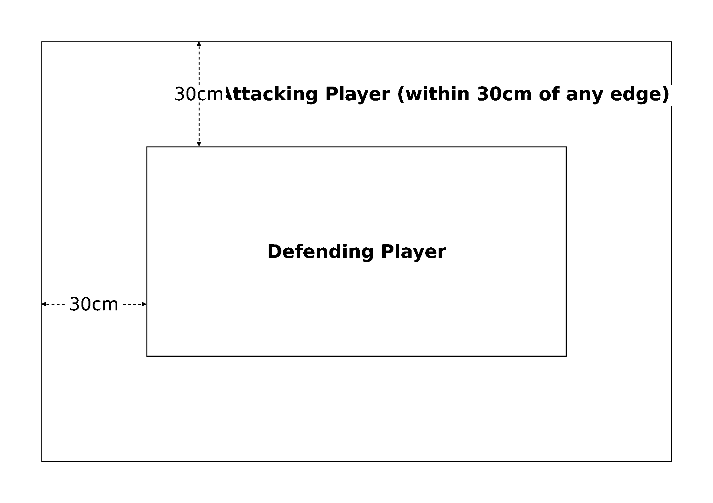

*Deployment diagram*

**First Turn.** The attacker takes the first turn.

**Special Rules.** The defender is caught unawares at the start of the battle. During the defender's first turn, none of their ships may go on special orders or attempt to disengage. Additionally, all defending ships start the game without any ordnance loaded (as if it had been expended), and will need to use the Reload Ordnance special order before they may launch or fire any ordnance.

**Game Length.** The game lasts until one fleet disengages or is destroyed.

**Victory Conditions.** Both fleets score victory points as normal, and the fleet with the highest victory point total at the end of the game wins.

*Flavour text:* "...and the Engines of Vaul will smite them, and bring fire upon them, and in agony they will depart this realm, their souls screaming into the black void that awaits their pitiful race. And with their banishment there will be peace in this place, and we will be one step further along the road we must tread...", Farseer Ulthos of Alaitoc

## Convoy

*Source: BFG:XR Rulebook, printed p.120. A distinct, simplified matched-play version, not the same as Raid Scenario Three (Convoy), above.*

Transport ships are easy prey for fleets of hungry warships, yet are vital to the war efforts of the endless conflicts across the galaxy. The attacker has set up a blockade just outside of the system, ready to intercept convoys laden with precious resources as they make their escape. The defender must work to escort the supply ships out of the system by driving off the attacking fleet.

**Forces.** Agree on a points limit for the battle. Both players may spend up to this limit on their fleets. In addition, the defender must include exactly 1 transport capacity worth of convoy ships for every 100 points (or portion thereof) in their fleet.

**Battlezone.** The attack takes place in the outer reaches. Use the appropriate table on rulebook p.51 to place celestial phenomena.

**Set-up.** The defender chooses one of the long table edges and deploys their fleet (not including any convoy ships) within 30cm of it. The attacker then sets up their fleet anywhere between 15cm and 45cm of the opposite table edge. Lastly, the defender sets up their convoy ships anywhere in their deployment area.

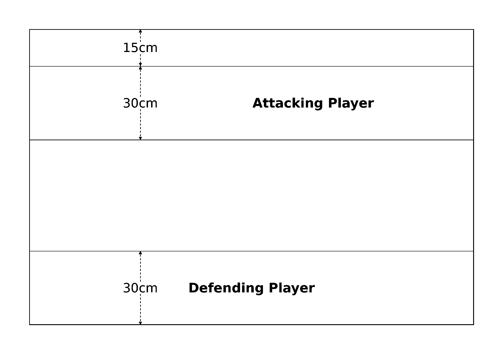

*Deployment diagram*

**First Turn.** The defender takes the first turn.

**Game Length.** The game lasts until the defender has no transport capacity left on the table.

**Victory Conditions.** Both fleets score victory points as normal, and the fleet with the highest victory point total at the end of the game wins. Each of the defender's convoy ships that disengages by moving off the attacker's long table edge awards the defender 100 victory points instead of counting towards the attacker's score. Otherwise, convoy ships that leave the board any other way are treated as destroyed and award the attacker an extra 50 victory points each (in addition to any victory point score based on their cost).

*Flavour text:* "Ours is to be an empire of worlds, not merely of castes or nations, or races or peoples. To simply control the worlds which we claim as our own will not be enough, we must control the paths between them also, or be divided, and so fail.", Air Caste Petition, Tau'n Campaign

## Space Assault

*Source: BFG:XR Rulebook, printed p.121.*

Space stations and orbital shipyards are the lifeblood of any space fleet. They are a place to repair, rearm, and refuel for the many warships of the Gothic sector and beyond. An attack on a space station will always be hard fought, but victory here will leave the enemy fleet in ruins and without a place to lick their wounds.

**Forces.** Agree on a points limit for the battle. Both players may spend up to this limit on their fleets. The defender must include a single space station, and may also include any number of orbital weapons platforms, defense laser platforms, and torpedo launchers. The costs of these are counted towards the defender's points total as normal (source: rulebook p.65-66).

**Battlezone.** The attack takes place in the primary biosphere. Use the appropriate table on rulebook p.51 to place celestial phenomena.

**Set-up.** The defender chooses one of the long table edges and deploys their fleet within 30cm of it. The space station must be deployed exactly 30cm from the chosen edge and equidistant from either short table edge, as shown below. Move any celestial phenomena as necessary such that none is within 10cm of the space station. Other orbital platforms are placed anywhere in the defender's deployment zone (rather than in the gravity well of a planet). The attacker then deploys their fleet anywhere within 30cm of the opposite long table edge.

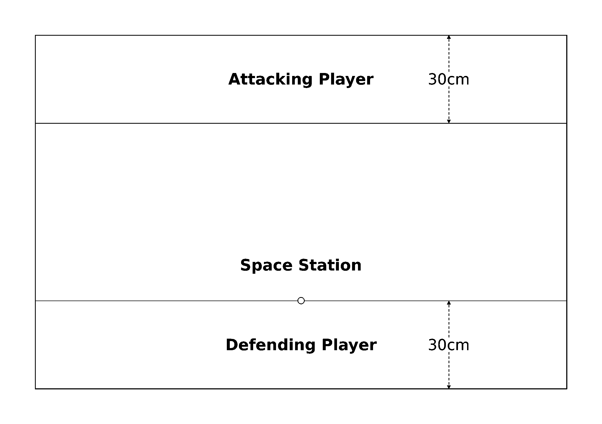

*Space station placement and deployment zones*

**First Turn.** The attacker takes the first turn.

**Game Length.** The game lasts until one fleet disengages or is destroyed.

**Victory Conditions.** Both fleets score victory points as normal, and the fleet with the highest victory point total at the end of the game wins. The attacker earns an additional 250 victory points if the space station is destroyed at the end of the game. Otherwise, the defender scores an additional 250 victory points if the station survives.

## Rescue

*Source: BFG:XR Rulebook, printed p.122.*

The commander's flagship narrowly escapes an enemy ambush and sends out a desperate distress signal. By a stroke of good fortune it is heard and answered by a defending fleet that moves to intercept. However the gods are fickle and cruel. It may yet be too late to rescue the fleeing vessel and the ensuing battle may cause more harm than good.

**Forces.** Agree on a points limit for the battle. Both players may spend up to this limit on their fleets. The defender's fleet must include a fleet commander and at least one capital ship (to which the fleet commander must be assigned). This is the defender's flagship for the purpose of this scenario.

**Battlezone.** The attack takes place in the outer reaches. Use the appropriate table on rulebook p.51 to place celestial phenomena.

**Set-up.** The defender chooses one of the short table edges and deploys their fleet (other than their flagship) within 30cm of it. The defending flagship is then placed at the exact center of the board, pointing directly at the defender's table edge. The attacker then sets up their fleet within 30cm of the opposite short table edge.

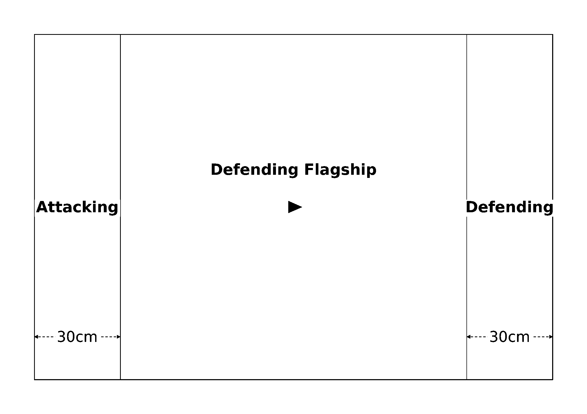

*Deployment diagram*

**First Turn.** The defender takes the first turn.

**Special Rules.** The defending flagship was sabotaged as part of the initial ambush. It may only disengage by moving off of the defender's short table edge. If it moves off any other table edge treat it as destroyed instead. Additionally, the defending flagship may not be issued special orders during the defender's first turn.

**Game Length.** The game lasts until one fleet disengages or is destroyed.

**Victory Conditions.** Both fleets score victory points as normal, and the fleet with the highest victory point total at the end of the game wins. The attacker earns an additional 100% of the defending flagship's cost in victory points if it is destroyed at the end of the game.

## Warp Storm

*Source: BFG:XR Rulebook, printed p.123.*

In the chaos of the warp there is little room for organized maneuvers. Fleets who enter together are often split apart, arriving to the battle in different places or times. In the midst of a warp-storm this chaos only intensifies, often throwing opposing fleets together into a jumbled mess. Scattered and disoriented, the first fleet to recover its formation is likely to emerge the victor.

**Forces.** Agree on a points limit for the battle. Both players may spend up to this limit on their fleets.

**Battlezone.** The attack takes place in deep space. Use the appropriate table on rulebook p.51 to place celestial phenomena.

**Set-up.** The attacker must first divide their fleet into two divisions with as close to the same number of capital ships and escort squadrons as possible. The attacker then deploys these divisions in opposite corners of the table, each within 30cm of the table edges comprising the division's corresponding corner, as shown below. The defender must do the same with their fleet and deploy using the other pair of opposing corners.

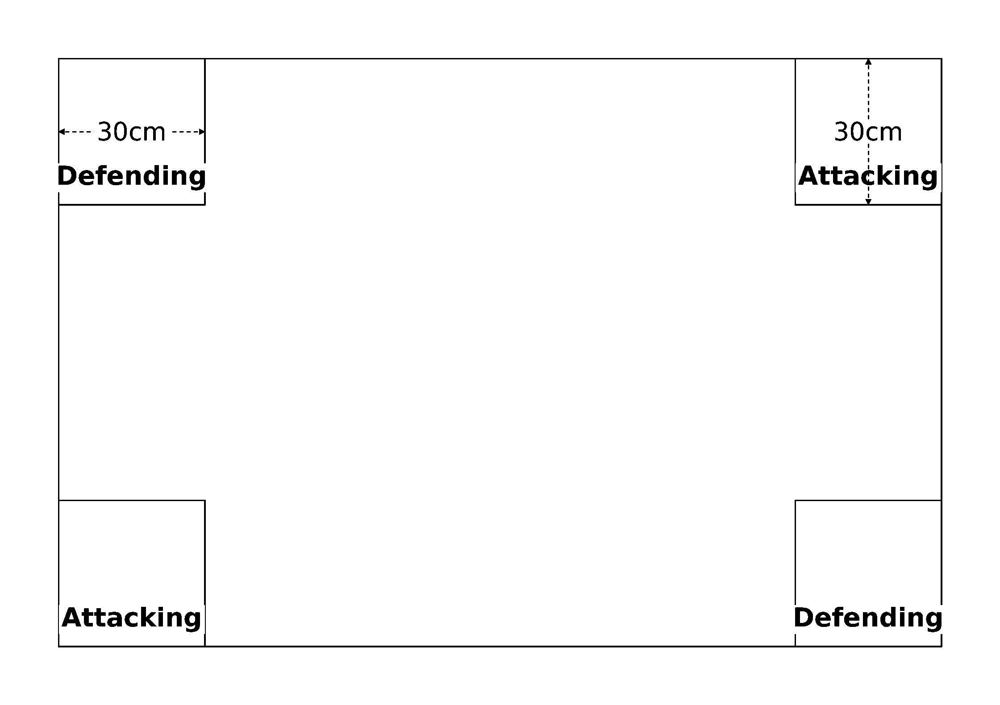

*Four-corner divisional deployment*

**First Turn.** The attacker takes the first turn.

**Game Length.** The game lasts until one fleet disengages or is destroyed.

**Victory Conditions.** Both fleets score victory points as normal, and the fleet with the highest victory point total at the end of the game wins. Each ship or squadron that disengaged during the battle must also take a leadership test at the end of the game; those that fail are lost in the warp and count as being destroyed instead.

*Flavour text:* "The Omnissiah directs our footsteps along the path of knowledge.", Techpriest Yaffel, Soylens Viridians for the Machine-Spirit

## Planet Strike

*Source: BFG:XR Rulebook, printed p.124.*

After months of drawn out fighting, a local uprising has created a gap in a strategically valuable planet's defensive perimeter. With conflict already raging below as rebels and loyalists battle for supremacy, the time has come for the attacking fleet to strike against its foes on the surface, bombarding their strongholds and deploying drop-troops to crush the defenders once and for all.

**Forces.** Agree on a points limit for the battle. Both players may spend up to this limit on their fleets. The defender may also spend up to an extra 20% of the agreed points limit on planetary defenses (not including low orbit defenses, as the low orbit table is not used in this scenario). The defender may also purchase planetary defenses with points allocated to their fleet, as described on rulebook p.65. The attacker must take 1 transport capacity worth of convoy ships for every 100 points (or portion thereof) in their fleet.

**Battlezone.** The attack takes place in the primary biosphere. Start by placing a large planet centered between the long table edges with the far side of the marker exactly 45cm from one of the short table edges. Use the appropriate table on rulebook p.51 to place any remaining celestial phenomena (or have a neutral third party set up terrain ahead of time). Do not place any more planets.

**Set-up.** The attacker deploys first, setting up their fleet within 30cm of the short table edge opposite the planet. The defender then sets up their fleet within 45cm of the other short table edge. Any planetary defenses included must be deployed within the planet's gravity well (rather than the defender's deployment zone) as normal.

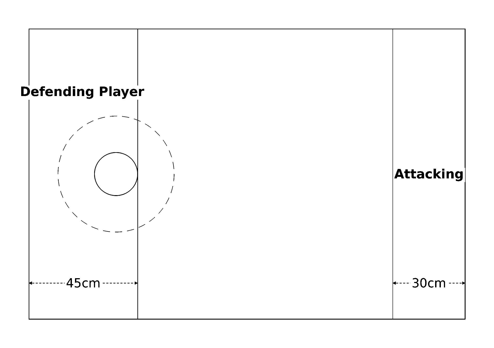

*Deployment diagram*

**First Turn.** The attacker takes the first turn.

**Special Rules.** The attacking player scores bombardment points by having ships hold position over the planet. For each attacking vessel that spends its entire turn stationary and in base contact with the planet marker, the attacker earns bombardment points equal to that ship's remaining hits plus its total transport capacity. Note that ships which can score extra assault points during a Planetary Assault may score extra bombardment points in the same way.

**Game Length.** The game lasts until one fleet disengages or is destroyed.

**Victory Conditions.** If the attacker holds the field at the end of the game, they win. Otherwise, look up the attacker's bombardment point total on the table below and roll a D6 to determine the result of the planetary invasion (if the attacker fails this roll, the defender wins).

| Bombardment Points | D6 Result |
|---|---|
| 0-5 | Defender Wins Automatically |
| 6-10 | Attacker wins on 6+ |
| 11-15 | Attacker wins on 5+ |
| 16-20 | Attacker wins on 4+ |
| 21-25 | Attacker wins on 3+ |
| 26-30 | Attacker wins on 2+ |
| 31+ | Attacker Wins Automatically |

## Domination

*Source: BFG:XR Rulebook, printed p.125-126.*

Some fight to save what they hold dear, while others fight to destroy that which they hate. Whether for glory or for blood, these are but the feeble aspirations of the violent masses. For real masters of warfare, it is not enough simply to attack and kill one's enemies; instead, true victory lies in the total domination of the battlefield.

**Forces.** Agree on a points limit for the battle. Both players may spend up to this limit on their fleets.

**Battlezone.** Before placing celestial phenomena, roll a D6 and look up the matching result among the six deployment diagrams at the end of this scenario. The chosen diagram is the deployment configuration the scenario will use. Place objective markers at all the indicated positions. Coins or small ship bases work the best for this purpose. The attack takes place in the primary biosphere. Use the appropriate table on rulebook p.51 to place celestial phenomena, keeping each feature at least 15cm from the center of any objective marker.

**Set-up.** The attacker deploys their fleet in one of the deployment zones indicated on the chosen deployment diagram. The defender then deploys in the opposite zone.

**First Turn.** The attacker takes the first turn.

**Game Length.** The game lasts until one fleet disengages or is destroyed, or until one player scores 10 or more objective points.

**Victory Conditions.** The aim of this scenario is to control as many objective markers as possible for as long as possible. An objective marker is controlled by a player if they have at least one ship within 15cm of it (measured from the center of the marker to the stem of the vessel) and their opponent does not. Note that objectives may never be moved, attacked, or destroyed during the course of the game. At the end of each player's turn, that player scores 1 objective point for each objective marker they control. The player with the most objective points at the end of the game wins.

*Flavour text:* "Beyond that opening are my enemies. Behind me are warriors who would happily turn their weapons on me if they thought they could get away with it. Do you really think I'm doing this to try and impress anyone? I know who I am, and I don't give a greenskin's fart what anyone thinks of me.", Honsou, Warsmith of the Iron Warriors

**Domination Deployments.** Roll a D6 before the battle and use the matching configuration below. Each shows the two deployment zones and the objective marker positions for that configuration.

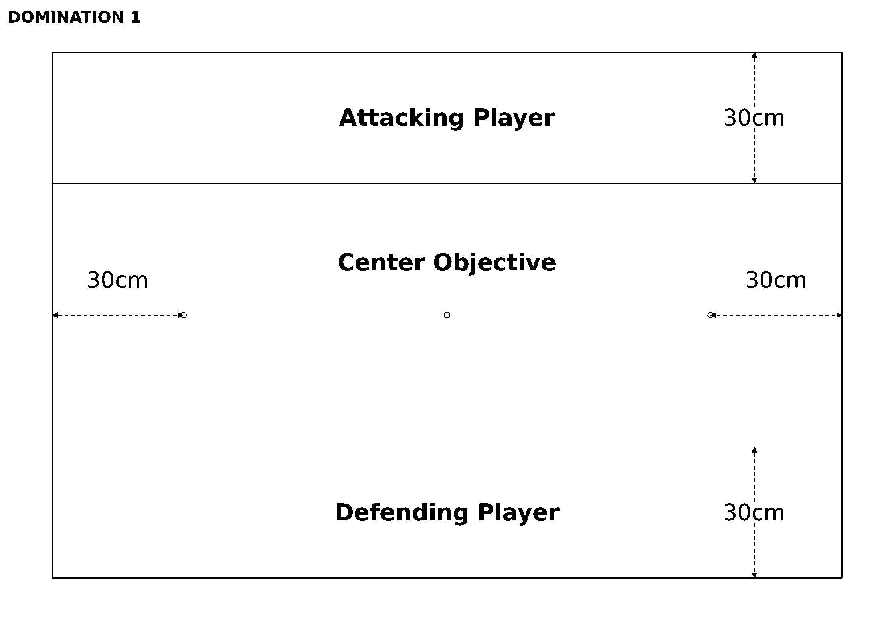

*Deployment 1 (D6 result: 1)*

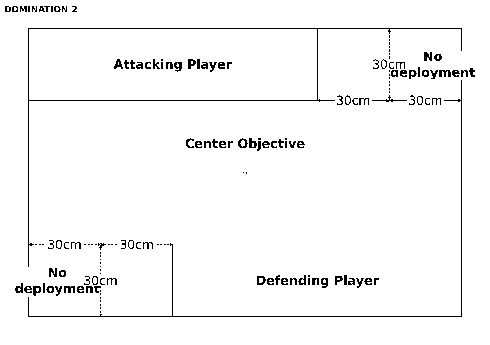

*Deployment 2 (D6 result: 2)*

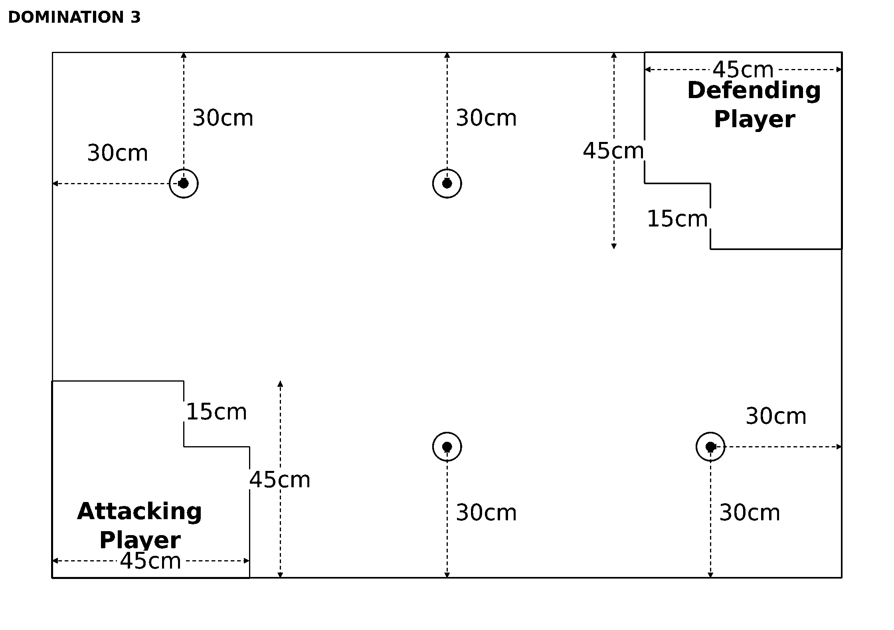

*Deployment 3 (D6 result: 3)*

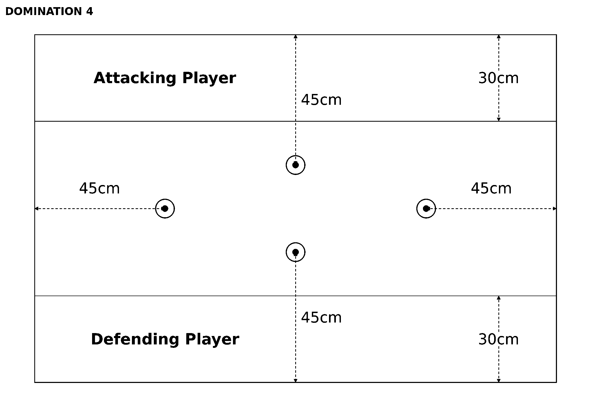

*Deployment 4 (D6 result: 4)*

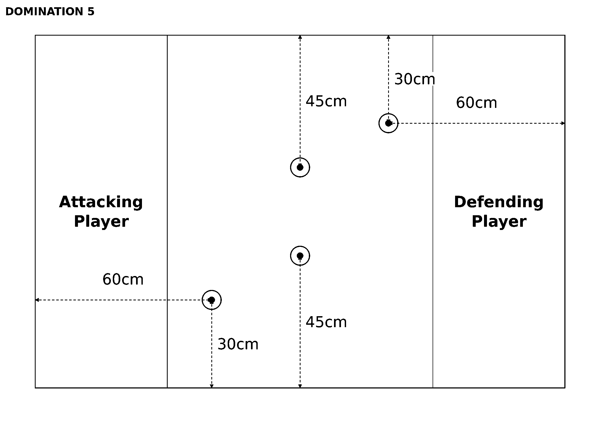

*Deployment 5 (D6 result: 5)*

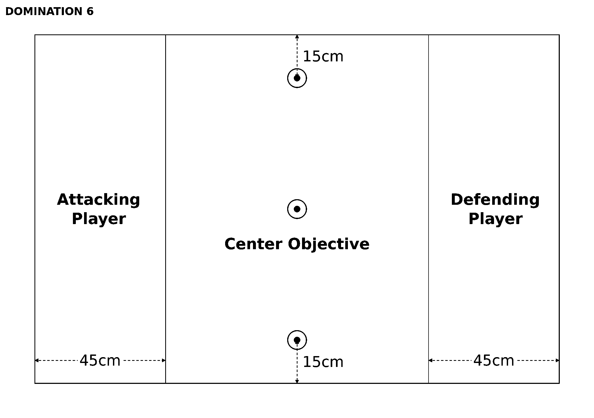

*Deployment 6 (D6 result: 6)*
