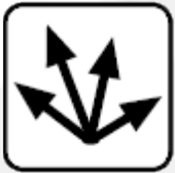
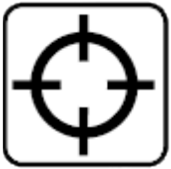
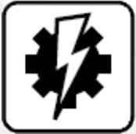

# Appendix 6 - Special Orders

*An at-a-glance summary of the six special orders. Full rules for each are in core section 7, Special Orders. Source: BFG:XR Rulebook, p.9.*

| Order | Speed | Turns | Shooting | Ordnance | Notes |
|---|---|---|---|---|---|
| **All Ahead Full**  | +4D6cm | None | Half | Full | Must move the maximum distance. Squadrons roll the bonus once, applied to every member. |
| **Come to New Heading**  | Half-full | Up to 2 | Half | Full | Must still move the minimum distance before each turn. |
| **Burn Retros**  | 0-half | Up to 1 | Half | Full | Does not need to move forward before turning. |
| **Lock On**  | Half-full | None | Full | Full | Re-roll failed to-hit rolls with lance and gunnery weapons. |
| **Reload Ordnance**  | Half-full | Up to 1 | Full | Full | All ordnance is reloaded. |
| **Brace for Impact**  | Half-full | Up to 1 | Half | Half | May be used any time the ship faces damage (but before the result is rolled). 4+ save vs hull hits and hit-and-run raids. Lasts to the end of your next turn. |
